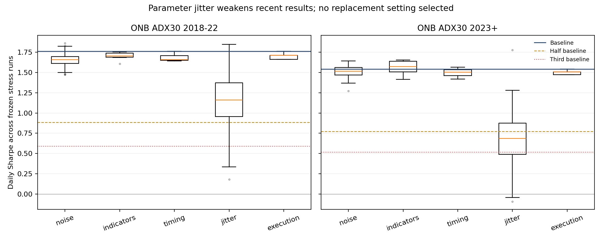

# Break tests: WATCH — ONB parameter sensitivity; Vault Break reproduction blocked

Summary: ONB ADX30 bends under price noise, indicator swaps, timing shifts and execution friction; joint jitter is MIXED.
For 2023+, jitter median Sharpe is 0.68 versus 1.54 baseline; 97% stay profitable but only 39% retain half the baseline Sharpe.
Vault Break fails the frozen reproduction gate: 1,700/1,743 reference entries match (97.53%); its stress runs were stopped.
Completed 316 mechanical runs: two baselines plus ONB's 314 fixed stress runs; no optimization or selected replacement.
No trading-plan, live, MultiCharts, VPS or account changes. These results require Claude's review.

Plan: [`break_vb_onb.md`](../plans/break_vb_onb.md), **109a752 committed before any baseline/test result**.
Task snapshot: `ece20f05bd8bac31424d10fc04e0e858f288c28e`; copied task under `agents/codex/inputs/break_vb_onb/`.
Scripts: `analysis/codex_break_vb_onb.py`, `analysis/codex_break_vb_onb_report.py`.
Output: `analysis/outputs/codex_break_vb_onb/`. Two registered robustness trials: ONB complete, VB stopped at parity.
Originally planned 630 total runs; 314 VB stress runs were not run. No best settings or new strategies were selected.

## Rule and frozen decision

VB: midnight noise/VWAP breakout, ATR 15 SMA, noise 0.30, 10:00–14:30 decisions, target 40 / stop 75 points, up to 3/day.
ONB evaluation: 23:00–08:30 range, top/bottom-third bias, 08:30–08:45 opening-range stop entry, ADX 14 > 30,
ATR 15 SMA stop 0.25 and 3R target, one/day, flat 14:30; reviewed holiday times. Fixed one NQ throughout.
Round-trip costs $7.25 plus one tick for each market/stop fill; target exits carry no extra slippage. Targets require
one point of trade-through. Stress execution cases extend costs/through-price exactly as preregistered.

Each family **BENDS** only when more than half its runs simultaneously stay profitable and retain at least half
that period's base Sharpe in **both 2018–22 and 2023+**. It **BREAKS** if median net<=0 or median Sharpe<third of base
in each period. Otherwise MIXED/WATCH. Overall ONB is **MIXED/WATCH** because joint jitter fails BENDS for 2023+;
no family satisfies the stronger BREAKS rule. A successful family is not proof of an enduring edge.

## Baseline reproduction gate

Both accelerated implementations reproduce their named original candidate functions trade by trade within numerical
tolerance. That is separate from matching MultiCharts. Matched keys are date/side/entry chart bar, with no fuzzy
day-only match; unmatched records remain in `*_baseline_pairing.csv`.

| Strategy | Python / MC on report overlap | Matched entries | Entries within one tick | Gross P&L within $20 | Gross correlation | Mean-net difference | Gate |
|---|---:|---:|---:|---:|---:|---:|---|
| VB | 1729 / 1743 | 1700 | 100.0% | 99.35% | 0.9959 | -$10.50 | FAIL: matched fraction of MC below 98% |
| ONB_ADX30 | 676 / 676 | 675 | 100.0% | 98.52% | 0.9995 | -$0.23 | PASS |

Tolerance gates were frozen before testing: >=98% matching each list, >=99% entry-price agreement, >=95% gross
P&L agreement within $20, correlation>=.98 and mean-net gap <=max($20,10% of MC mean). Entry-price, gross-tolerance and correlation
columns use common entries; mean-net differences use the complete overlapping lists. Matching fractions include
all reference/replica entries in the overlap.
VB's full 2018–26 candidate has 1,742 trades; its report-overlap comparison excludes early warm-up entries before
the report's January 25, 2018 11:00 start. ONB comparison uses the supplied ADX30/.25 report, not ADX20 or funded ML.

ONB unmatched dates: Python-only **2020-03-18**; MC-only **2025-11-28**. These rows remain in the evidence.

VB target diagnostic: 43 of 896 MultiCharts target exits have an observed
reported exit-bar high below target+one point in the owned minute data. On 2018-04-17, the first target was 6832.50,
the MC exit bar ended 13:30 with an observed high 6833.25, and the Python one-point-through model exited later.
That can change later re-entry opportunities even when the first trade's profit is the same. This identifies an
execution/data-reconciliation issue; it does **not** establish a replacement fill threshold or explain every unmatched
trade. Source-data differences, report assumptions and the actual MC fill convention need checking. No threshold was
changed to make the gate pass. VB gets **PARITY FAIL / inconclusive stress evidence**, not an economic-edge failure.

For transparency, the unvalidated VB Python baseline only:

| Period | Trades | Net/NQ trade | t | Daily Sharpe | Total net/NQ |
|---|---:|---:|---:|---:|---:|
| 2018-22 | 861 | $76 | 2.71 | 1.17 | $65,788 |
| 2023+ | 881 | $87 | 2.66 | 1.26 | $76,428 |

All VB side/year metrics remain in `run_metrics.csv`; shorts are N/A because VB is long-only. No VB stress family
verdict is invented. Resolving its fill parity is the prerequisite to completing that audit, under the original gate.

## ONB baseline results

Per fixed one NQ, after costs. Daily risk metrics use intraday closed P&L on the full available trading calendar;
an initial zero observation ensures the first loss counts in drawdown. $50k is only the Ulcer reporting denominator,
not a capital recommendation or the variable RiskPerTrade 1100 MNQ deployment. Full2018–26 and year/side tables are saved.

| Period | Side | Trades | Win | Net/trade | t | Sharpe | Sortino | PF | Calmar | Ulcer | Max DD |
|---|---|---:|---:|---:|---:|---:|---:|---:|---:|---:|---:|
| 2018-22 | all | 364 | 50.8% | $340 | 4.05 | 1.76 | 3.85 | 1.77 | 3.19 | 3.56 | $7,581 |
| 2018-22 | long | 185 | 55.7% | $289 | 3.04 | 1.32 | 2.67 | 1.81 | 1.24 | 3.26 | $8,466 |
| 2018-22 | short | 179 | 45.8% | $392 | 2.81 | 1.22 | 2.79 | 1.74 | 1.65 | 4.99 | $8,295 |
| 2023+ | all | 312 | 51.3% | $409 | 3.06 | 1.54 | 3.10 | 1.58 | 2.43 | 3.25 | $13,571 |
| 2023+ | long | 174 | 54.0% | $390 | 2.32 | 1.17 | 2.30 | 1.60 | 1.28 | 3.84 | $13,695 |
| 2023+ | short | 138 | 47.8% | $433 | 2.01 | 1.01 | 2.08 | 1.55 | 1.30 | 4.84 | $11,887 |

| Year | All net/NQ | Longs | Shorts |
|---|---:|---:|---:|
| 2018 | $7,361 | $3,894 | $3,466 |
| 2019 | $3,681 | $4,085 | -$405 |
| 2020 | $14,769 | $13,580 | $1,189 |
| 2021 | $36,915 | $11,612 | $25,304 |
| 2022 | $60,927 | $20,383 | $40,544 |
| 2023 | $12,928 | $13,610 | -$683 |
| 2024 | $68,958 | $28,738 | $40,220 |
| 2025 | $19,628 | $11,020 | $8,609 |
| 2026 | $26,054 | $14,473 | $11,582 |

## ONB stress families

Medians across every predeclared run; net totals and means are per fixed NQ. Positive+t>2 and positive+half-Sharpe
are separate diagnostic shares. Per-run trade-t is not a new promotion test, and draw/seed outcomes are correlated.

| Family | Period | Runs | Median total | Median net/trade | Median t | Median PF | Median Sharpe | Median max DD | Net>0 | Net>0 & t>2 | Net>0 & half Sharpe | Verdict |
|---|---|---:|---:|---:|---:|---:|---:|---:|---:|---:|---:|---|
| noise | 2018-22 | 100 | $117,207 | $319 | 3.80 | 1.71 | 1.66 | $10,475 | 100% | 100.0% | 100.0% | BENDS |
| noise | 2023+ | 100 | $125,431 | $400 | 3.01 | 1.56 | 1.52 | $13,573 | 100% | 100.0% | 100.0% | BENDS |
| indicators | 2018-22 | 6 | $118,554 | $326 | 3.91 | 1.73 | 1.71 | $7,586 | 100% | 100.0% | 100.0% | BENDS |
| indicators | 2023+ | 6 | $129,962 | $417 | 3.12 | 1.59 | 1.57 | $13,150 | 100% | 100.0% | 100.0% | BENDS |
| timing | 2018-22 | 3 | $113,054 | $314 | 3.81 | 1.73 | 1.66 | $8,963 | 100% | 100.0% | 100.0% | BENDS |
| timing | 2023+ | 3 | $126,757 | $406 | 2.98 | 1.55 | 1.51 | $13,887 | 100% | 100.0% | 100.0% | BENDS |
| jitter | 2018-22 | 200 | $75,458 | $208 | 2.65 | 1.47 | 1.16 | $11,603 | 100% | 80.5% | 80.5% | MIXED / WATCH |
| jitter | 2023+ | 200 | $49,892 | $180 | 1.35 | 1.24 | 0.68 | $24,666 | 97% | 12.0% | 39.0% | MIXED / WATCH |
| execution | 2018-22 | 5 | $120,198 | $330 | 3.93 | 1.74 | 1.71 | $8,011 | 100% | 100.0% | 100.0% | BENDS |
| execution | 2023+ | 5 | $124,584 | $399 | 2.99 | 1.56 | 1.51 | $13,631 | 100% | 100.0% | 100.0% | BENDS |



The boxes show variation across specified scenarios, not confidence intervals or independent samples.
Noise broken out by its two predeclared sizes:

| Noise SD | Period | Seeds | Median total | Median Sharpe | Positive & t>2 |
|---|---|---:|---:|---:|---:|
| 1 ticks | 2018-22 | 50 | $117,875 | 1.67 | 100% |
| 1 ticks | 2023+ | 50 | $126,407 | 1.53 | 100% |
| 2 ticks | 2018-22 | 50 | $116,154 | 1.65 | 100% |
| 2 ticks | 2023+ | 50 | $124,226 | 1.50 | 100% |

Indicator runs were ATR 10/20 SMA, ATR 10/15/20 Wilder and OR ending 09:00 with the actual 08:30 open retained.
Timing runs were entry delayed 15m, flat 15m earlier and flat 15m later. The delayed-entry version remains positive:
net/trade $314 / $360, Sharpe 1.66 /
1.42 across the two periods. This is a historical robustness perturbation, not a recommendation
to change the live entry. All execution cases—including 3-tick market/stop slippage and 2-point target-through—remain
positive and retain half base Sharpe in both periods.

## Jitter, side risks and dependency flags

Exactly 200 feasible simultaneous ±10% perturbations were evaluated. Raw draws: 822; infeasible before any
return evaluation: 622. Their original factors, proposed parameters and rejection reasons are saved
in `ONB_ADX30_jitter_draws.csv`. Constraints are chronological/calendar feasibility, not profitability. Conditioning on
those constraints makes retained parameters dependent. Clocks were multiplied in elapsed minutes, snapped to 15m,
and capped before 15:59 / holiday 11:45. The previous-day overnight start stayed on an unwrapped axis, including
post-midnight starts correctly. Native bar size, boolean holiday handling and fixed-unit sizing stayed unchanged.

Design jitter: 200/200 profitable. Recent jitter:
194/200 profitable, 24/200
positive with t>2; only 78/200
positive with half base Sharpe. Recent median drawdown rises from baseline $13,571 to
$24,666 per NQ. Joint specification changes materially weaken recent risk-adjusted results.
The frozen numeric-clock jitter is broad: accepted overnight-end times range from 07:45 to 09:15, OR-end times from
08:00 to 09:30, and regular flat times from 13:00 to 15:45. Overnight start ranges from the preceding 20:45 to
current-day 01:15. These alter the traded session substantially; this result does not establish fragility to a tiny
implementation error. Actual input ranges are retained below and in the CSV.
This does not isolate a single causal parameter; no post-hoc OAT rescue or preferred jitter draw was tested.

Whole-strategy deterministic settings flagged at loss or below one-third base Sharpe: **0**.
Side-specific flagged rows: **0**; every check is saved in
`deterministic_dependency_checks.csv` / `dependency_flags.csv`. No isolated deterministic swap in the registered set
was necessary to keep the whole ONB profitable, but that does not erase the joint-jitter weakness.
`ONB_ADX30_jitter_input_ranges.csv` records actual distinct values after rounding; e.g. structural EntryBufTicks 2,
RiskPerTrade 0 and fixed one-contract units were not transformed into new sizing or live-buffer strategies.

| Family | Period | Side | Median total | Median t | Median Sharpe | Median PF | Median max DD |
|---|---|---|---:|---:|---:|---:|---:|
| execution | 2018-22 | long | $51,739 | 2.94 | 1.28 | 1.77 | $8,746 |
| execution | 2018-22 | short | $68,459 | 2.74 | 1.19 | 1.72 | $8,700 |
| execution | 2023+ | long | $66,146 | 2.26 | 1.14 | 1.58 | $13,755 |
| execution | 2023+ | short | $58,438 | 1.97 | 0.99 | 1.54 | $12,007 |
| indicators | 2018-22 | long | $54,169 | 3.09 | 1.34 | 1.82 | $8,247 |
| indicators | 2018-22 | short | $63,437 | 2.66 | 1.16 | 1.68 | $8,098 |
| indicators | 2023+ | long | $69,953 | 2.37 | 1.19 | 1.62 | $13,234 |
| indicators | 2023+ | short | $63,335 | 2.11 | 1.06 | 1.59 | $12,039 |
| jitter | 2018-22 | long | $35,529 | 2.22 | 0.97 | 1.54 | $6,483 |
| jitter | 2018-22 | short | $41,078 | 1.81 | 0.79 | 1.44 | $10,388 |
| jitter | 2023+ | long | $40,402 | 1.57 | 0.79 | 1.37 | $14,615 |
| jitter | 2023+ | short | $11,379 | 0.44 | 0.23 | 1.11 | $18,916 |
| noise | 2018-22 | long | $52,813 | 2.99 | 1.30 | 1.78 | $7,114 |
| noise | 2018-22 | short | $64,366 | 2.56 | 1.12 | 1.66 | $10,539 |
| noise | 2023+ | long | $65,649 | 2.23 | 1.13 | 1.57 | $13,692 |
| noise | 2023+ | short | $61,109 | 2.06 | 1.03 | 1.56 | $11,578 |
| timing | 2018-22 | long | $48,490 | 2.84 | 1.24 | 1.74 | $8,921 |
| timing | 2018-22 | short | $66,901 | 2.78 | 1.21 | 1.76 | $9,305 |
| timing | 2023+ | long | $66,350 | 2.31 | 1.16 | 1.59 | $12,890 |
| timing | 2023+ | short | $56,209 | 1.98 | 1.00 | 1.57 | $10,845 |

Full Sortino, Calmar, Ulcer, win rates and all individual side/year results are in `run_metrics.csv`; grouped
side/year medians are in `stress_side_year_summary.csv`. Long/short diagnostics do not select a new side-only rule.

## Controls, uncertainty and account applicability

Master seed 8675309, all 100 price-noise realizations and 200 accepted jitter settings retained. Noise is independent
across minute OHLC fields before tick rounding and OHLC projection; volume/NaN masks stay fixed. Both indicators
and fills use the perturbed prices. ATR/Wilder use completed past weekday ranges, including explicit first-n seeding.
Noise scenarios are an artificial stress model, not a claim about actual market-data measurement error.

ONB 2023+ baseline 10-session-block bootstrap 90% Sharpe interval [0.89, 2.28]; all/long/short intervals and
drawdown permutations are saved. Those describe uncertainty conditional on this history. The 2023+ sample has been
seen repeatedly in prior research; these stress results are historical sensitivity, not fresh validation. No new
entry-time/random-side placebo or funded addition/replacement bench was run for this unchanged-strategy audit.
No account-size, payout, broker-margin or blow-up conclusion follows from fixed-one-NQ metrics. Two copied live
account orders would not be independent market evidence; this audit does not use those execution rows as a sample.

## Implementation verification and limits

All 8 engineering checks pass: native-bar delay activation, no late delayed entry, extended OR using both
completed bars, future OR extrema excluded, Wilder seed/past-only availability, repeatable OHLC-valid noise and jitter
clock constraints. Accelerators were compared with the named original generators before stress runs; matching a
candidate is not the same as passing the independent MC gate. No stress was run before plan 109a752.
The early first implementation stopped on JSON serialization of a NumPy boolean after computing baselines; that
serialization defect was fixed before any stress results. No gate, signal or parameter definition changed afterward.

The configured `scratch_data/g24.pkl` was reused read-only and checked against owned day/night CSV observations;
cache/source hashes, observed span and matched input row count are in `input_manifest.json`. Data ends 2026-10-09.
Warm-up starts 2017-12-01 with the existing overnight observations; the new 2017 daytime export was not needed for
ONB's close baseline match. No shared cache, data file or source strategy was rebuilt/overwritten. Continuous-contract
provenance, holiday/provider differences and minute OHLC path assumptions remain limits. ONB's source candidate
also retains the repository's entry-minute stop/target convention; this is not an independent tick-engine audit.
Current live market-fallback/entry-buffer/rejection guards are outside the historical report/candidate comparison.

## Reproduction and review

```bash
/workspace/venvs/thebeginning/bin/python analysis/codex_break_vb_onb.py
/workspace/venvs/thebeginning/bin/python analysis/codex_break_vb_onb_report.py
```

All tested seeds/settings, raw infeasible draws, per-run metrics, parity pairs, diagnostics, source/code hashes and
package versions are committed. No PowerLanguage code, trading plan, live/VPS file, account or ranked list changed.
The outcome is an evidence report: ONB MIXED/WATCH; VB reproduction blocked. Resolving VB parity requires source/
execution review, not loosening the frozen gate or silently choosing a better fill threshold.

Tell Claude: review `agents/codex/results/break_vb_onb.md`, especially the VB target-fill discrepancy and ONB's weaker
2023+ simultaneous-parameter-jitter distribution; no live or plan action has been taken.
