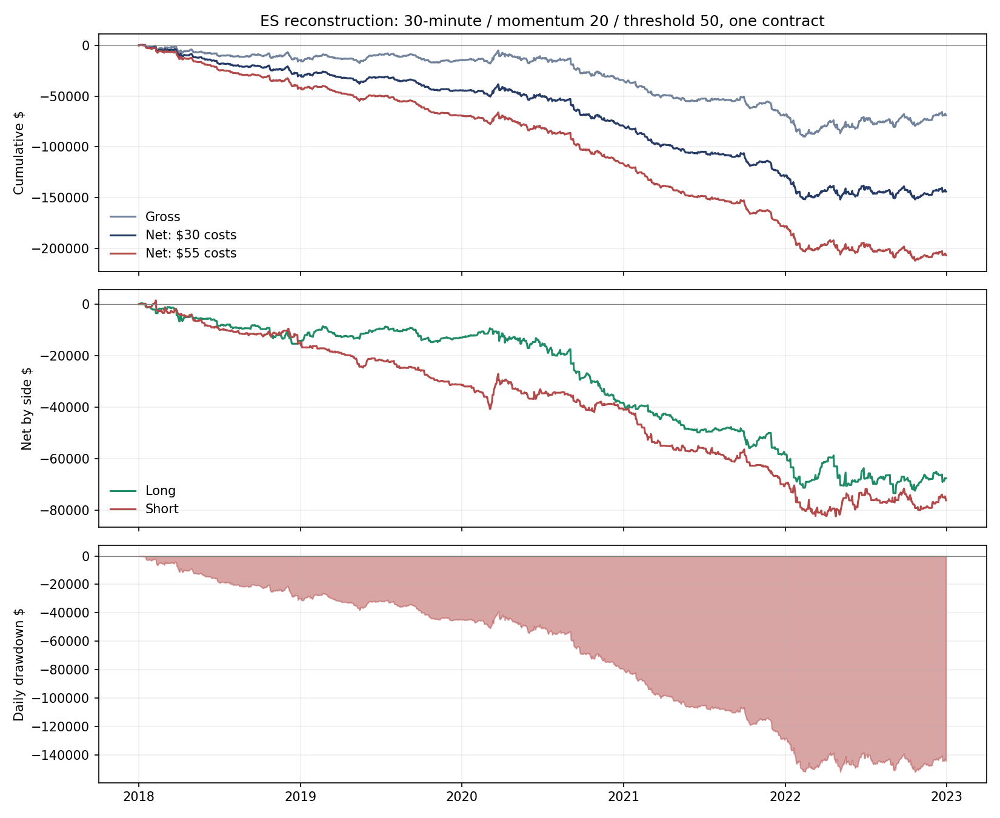

# Davey-inspired ES momentum/Keltner: REJECT — the chosen reconstruction loses before costs

Summary: Tested one discretionary reconstruction of the user's incomplete ES strategy screenshot, 2018–22.
2,504 trades: gross/trade -$27.50, net/trade -$57.50, net -$143,982.50, t -4.16.
Both sides lose and all five design years are negative; two-tick fills and doubled costs also fail.
Stop here: no optimization, 2023+, account bench or live code; this does not refute the author's unknown settings.

Plan: [`davey_keltner_screen.md`](../plans/davey_keltner_screen.md), **d8718f9 committed before returns**.
Evidence: [`davey_keltner.md`](../evidence/davey_keltner.md).
Scripts: `analysis/codex_davey_keltner.py`, `analysis/codex_davey_keltner_report.py`.
Outputs: `analysis/outputs/codex_davey_keltner/`.
Trials: **2 execution variants of one rule, plus 1 analytic double-cost rescore; 1,000 conditional random-side controls**.

## Rule (as tested)

ES, one full contract; daytime 30-minute bars. Momentum **20 bars both sides**, Keltner **5 bars, ±0.5 ATR**,
threshold **50**. Center SMA5, true-range averages SMA5/SMA15. The screenshot/transcript do not provide the
momentum values, threshold, chart interval/session, exact platform version or order settings. These are explicitly
chosen assumptions, not recovered author settings. At threshold 50, the channel-width term cancels: this buys
below SMA5 when above C[20], sells above SMA5 when below C[20]. Channel rank is not clipped to [0,100].

Next-minute-open market entries/exits, one position, no pyramiding; contrary signals can reverse. Long exits
when rank>50, short when rank<50. Stop initially 4×ATR15 long / 1× short; reset from the entry reference at each
later decision using completed ATR, allowing widening. No profit target. Stop active on the entry minute;
carried gaps fill at the observed open. Repository `grid._walk` traverses minute OHLC; its general fixed-bracket
engine is extended because this rule needs changing stops and indicator exits.

Normal session 08:30–15:00 CT, chart closes 09:00 onward; early-close session ends 11:30 per the repo calendar.
Scheduled exit is the open of the minute stamped 15:00, actual 14:59 CT; early 11:29 CT. This extra intraday exit
is an adaptation: the screenshot contains no scheduled flatten. Only complete observed 30-minute bars inform
decisions; missing bars are not forward-filled. 2017 ES is warm-up only; returns use 2018–22 exclusively.

Costs are $5 ES commission plus $12.50 each market/stop fill: **$30 round trip**. Stress uses two adverse ticks
each way, **$55**. Prices/stops use raw reference levels, costs deducted afterward as in repo convention;
this does not shift stop anchors by the charged entry slippage. No MES fill or capital recommendation is made.

## Results

All amounts are per one full ES with no compounding, leverage scaling, account stop or margin simulation.
Daily P&L is booked on each intraday trade's date; zero on no-trade dates. Initial zero is included for drawdown.
The $50k denominator used by `metrics.perf` is a reporting convention: this loss path crosses zero capital,
so percentage/Ulcer statistics are mathematical diagnostics, not a survivable $50k account simulation.

| Side | Trades | Win | Net/trade | Trade t | Daily Sharpe | Sortino | PF | Calmar | Ulcer | Max daily DD |
|---|---:|---:|---:|---:|---:|---:|---:|---:|---:|---:|
| all | 2504 | 57.2% | -$57.50 | -4.16 | -1.93 | -2.29 | 0.77 | -0.18 | 170.56 | $152,162.50 |
| long | 1254 | 62.0% | -$53.98 | -2.75 | -1.20 | -1.38 | 0.76 | -0.18 | 77.58 | $73,855.00 |
| short | 1250 | 52.3% | -$61.03 | -3.14 | -1.52 | -1.92 | 0.79 | -0.18 | 94.07 | $83,972.50 |

Combined net daily t **-4.38**. Gross total **-$68,862.50**, commission/slippage
**$75,120.00**, mean hold **72.1 minutes**, worst trade **-$5,192.50**.
Gross means: longs -$23.98, shorts -$31.03.
The 62.0% long win rate still loses money; asymmetric/wide losses matter.
Trades with at least one stop widening: **1,147/2,504 (45.8%)**.
Exit types: stop 458, indicator 1379, reversal 169,
scheduled flatten 498. All fills remain intraday; missing entry activations 0,
late scheduled exits 0.

Calendar-year net:

| Year | Combined | Longs | Shorts |
|---|---:|---:|---:|
| 2018 | -$29,550.00 | -$14,272.50 | -$15,277.50 |
| 2019 | -$15,012.50 | $1,250.00 | -$16,262.50 |
| 2020 | -$34,867.50 | -$25,305.00 | -$9,562.50 |
| 2021 | -$49,072.50 | -$20,080.00 | -$28,992.50 |
| 2022 | -$15,480.00 | -$9,287.50 | -$6,192.50 |

Execution/cost checks (same fixed signal and raw-price path):

| Variant | Trades | Total net | Net/trade | Trade t |
|---|---:|---:|---:|---:|
| primary | 2504 | -$143,982.50 | -$57.50 | -4.16 |
| two_tick | 2504 | -$206,582.50 | -$82.50 | -5.97 |

Double total primary costs ($60/trade): **-$219,102.50**.
Observed trade SD $691.16 gives an approximate t=2 net-mean hurdle
**$27.62**, versus observed -$57.50. Trading-day dependence remains relevant.
Failed gates: `net_trade_t_at_least_2, net_daily_t_at_least_2, gross_mean_at_least_45, three_positive_years, stress_positive, double_total_cost_positive, conditional_random_side_p_le_05`. The >=100-trade, engineering and no-late-flat gates pass; the economic gates fail.



**2023+ not opened.** No historical-replication results, side-only rescue or alternative settings were run.
The result rejects these chosen parameters/session; an omitted timeframe or threshold could behave differently.
The screenshot is insufficient to attribute this result to Davey's actual strategy.

## Placebos and account level

1,000 full single-position random-side replays at the original nonzero opportunity decisions, with side-specific
stops/exits unchanged. Conditional p **0.262** for controls at least as profitable as the
strategy. Control total-net 5/50/95%: -$214,642.00 / -$163,658.75 / -$113,863.50. Most controls also lose.
Direction randomization can alter holding times/trade counts; this conditions on the original opportunity clock
and does not validate independent timing or remove source selection. It cannot rescue the failed cost screen.

Design diagnostics, 2,000 ten-session-block bootstrap draws and 2,000 daily permutations:

| Side | Daily Sharpe 90% block interval | 95th percentile shuffled daily DD |
|---|---:|---:|
| all | [-2.65, -1.17] | $158,015.00 |
| long | [-1.80, -0.56] | $82,460.75 |
| short | [-2.20, -0.80] | $88,367.50 |

These are uncertainty diagnostics of the chosen losing rule, not independent confirmation. Bootstrap PF is
daily aggregation (`pf_day`), whereas the main table's PF is per trade. Full metric intervals and permutations
are saved. The bootstrap uses exactly the observed trading dates; main metrics also prepend one zero for DD,
causing an immaterial one-observation difference in annualized point estimates.

No funded addition/replacement/empty-slot bench, Apex Monte Carlo, personal-account sizing or live code:
the cheap edge gate failed. Saved occupancy context was disclosed before testing; candidate events were never
selected for plan-flat dates. Joint losses/diversification remain unmeasured.

## What could make this wrong

- **Reconstruction:** chosen 20/20/50 and 30-minute daytime bars are unknown-author substitutes. Threshold 50
  reduces to a center crossing. No optimization was used to make the result look better. The source's claimed
  post-June 2021 performance is not our independent holdout: parameters and raw ledger were not supplied.
- **Indicators/platform:** SMA Keltner/ATR, observed-bar history, reversals/no pyramiding, tick rounding and
  first-minute protection are frozen research definitions. Official TradeStation/MultiCharts parity remains
  unverified; the screenshot's conditional stop statements may have different entry-bar behavior.
- **Data/fills:** continuous ES roll/back-adjustment provenance and quote-level execution are unverified.
  The audit found partial/absent bars; absent scheduled-flat observations occurred only on dates with zero
  complete RTH bars/signals. No held exit required a late fill. These include an unexplained no-RTH date,
  2020-11-30; it is preserved in `missing_flat_audit.csv`, not silently assigned a profitable trade.
- **Risk:** stop distances can widen and differ 4:1 across sides; one ES is not fit to the Apex trail merely
  because it is the video's baseline. Pre-return median long stop proxy was $2,066.67, 95th percentile $5,493.33.
  Actual worst trade -$5,192.50. A stop is not a guaranteed loss cap; actual spreads/slippage can be worse.
- **Prior selection:** 2018–22 overlaps the author's development and many prior repository pattern tests.
  A predeclared reconstruction does not erase that history. A failed arbitrary reconstruction cannot establish
  that every possible implementation fails; no new rule is selected after seeing these outcomes.

## Verification and reproduction

**13 engineering checks passed before primary replay**, including entry-minute stops, gaps,
next-open exits, causally updated widening stops, reversal/no pyramiding, missing-entry cancellation,
early flatten, historical-prefix invariance and ES cost scaling. **7 saved-ledger check groups**
verify original signal/next-open/initial-stop consistency, tick levels, no overlapping positions, design-only
dates, intraday exits, arithmetic and daily side reconciliation. These are engine checks, not platform parity.

Source/data/code/config hashes and dependency versions are preserved. No shared cache was built or changed.
No live/VPS/broker/API-key access or source-branch push occurred.

```bash
/workspace/venvs/thebeginning/bin/python analysis/codex_davey_keltner.py --run
/workspace/venvs/thebeginning/bin/python analysis/codex_davey_keltner_report.py
```

The optional `--audit` mode rebuilds counts/features/power only, without returns. The committed pre-return
counts and manifest establish what was known before the plan. The return runner checks that the plan content
is committed before executing. No change to the rule or correctness rerun was required after return inspection.

## Differences between MultiCharts code and the test

No new MultiCharts code was written. Relative to the supplied screenshot: missing inputs/chart/session/order
settings are filled explicitly; one-contract/no-compounding sizing retained; scheduled intraday flatten added;
entry-minute stop protection specified; signal/indicator calculations, minute data, gap fills and cost treatment
fixed above. Original source transcript/transcription remain unchanged. Send the result path to Claude for review.
