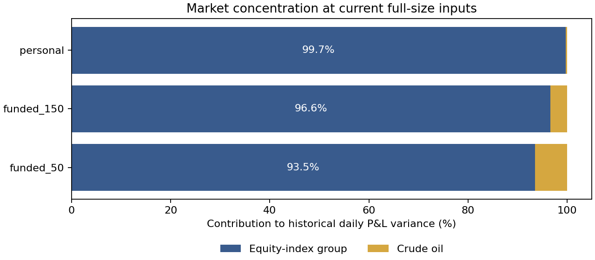

# Current portfolio audit: concentrated equity risk; live-risk certification incomplete

Summary: Native-cost accounting is positive historically, but strategy count overstates market diversification.
NQ supplies 91.9%/95.8% of 50K/150K funded daily variance; equity-index sleeves supply 99.7% of personal variance.
Documented rosters and modeled native-cost integer quantities reconcile; missing adverse minutes and source-version/sizing gaps block a certified live-floor claim.
No strategy was added, removed, resized or promoted. The next alpha search should address this concentration with independently evidenced exposure.

Authorization: user requested a portfolio audit. [Evidence](../evidence/portfolio_audit_20261031.md),
[preregistered protocol and implementation corrections](../plans/portfolio_audit_20261031.md), initial commit `671f7f1`.
Source snapshot: Claude `c3126aa01796133f3aecb368e688726931dea440`. Exact initial audit code committed `e85fc0f` before outcomes;
later accounting/admission/preset corrections are separately committed and failed results retained.
Code: `analysis/codex_portfolio_audit_{config,prepare,run,verify,diagnostics,report}.py`.
Outputs: `analysis/outputs/codex_portfolio_audit_20261031/`; metadata, source/settings/cache hashes and parity records included.
New alpha definitions:0. Five existing homes; three declared cost scenarios. No removal/addition/replacement optimization.

## What this audit can establish

These are historical recorded-ledger diagnostics and conditional account-model baselines. They are not verified live
execution returns, a new prospective holdout, current account pass odds or certified Apex breach probabilities.
Main commission is $1.04 per micro round trip: the user reports MNQ measured $0.99–1.08 and uses $1.04; MES/MCL
have never been traded live and $1.04 is assumed. Main slippage is one native tick per market/stop fill, no slipped
target-limit exit. Native point/tick values are MNQ $2/.25, MES $5/.25, MCL $100/.01. Every reentry pays.
Fee sensitivity is $1.24 RT/one tick; stress is $2.08 RT/two ticks. Neither model quotes nor actual realized slippage are verified.

The earlier stored fund-plan curves often used $7.25/NQ divided by 10=$0.725/MNQ; ES used $0.50/MES.
This audit rebuilds native cash/cost arithmetic from the recorded raw fills instead. It does not rescale a
full-contract dollar commission or silently count later missing order-flow signals as no trades.

## Frozen current rosters

Latest source commit 6082472 explicitly reverses the funded Swing Target swaps.50K funded is VB2/1 plus T_ONESIDE;
150K is back to Dual Thrust 2. Swing Target remains personal. The T_ONESIDE decision row misleadingly says
REVERTED while the current cushion table and NEW_CHAT_BRIEF retain T; this audit follows those explicit current inputs.
No old Swing Target funded allocation was substituted for today's portfolio.

| Home | Frozen full-size inputs |
| --- | --- |
| evaluation_50 | VB: 8, ONB30: risk $1100 / 0.25 ATR, EOS: risk $500 / 0.3 ATR, BRIDGE: 2 |
| evaluation_150 | VB: 20, ONB30: risk $2750 / 0.25 ATR, EOS: risk $1250 / 0.3 ATR, BRIDGE: 5 |
| funded_50 | VB_N: 2, VB_F: 1, ONBML: risk $400 / 0.3 ATR, OT: 1, EOS: risk $700 / 0.3 ATR, LDF: 2, NFP: risk $500 / 0.5 ATR, BRIDGE: 1, CLS: 2, MOC: 2, TOS: 1 |
| funded_150 | VB_N: 3, VB_F: 1.5, ONBML: risk $600 / 0.3 ATR, MON: 1.5, EOS: risk $1050 / 0.3 ATR, LDF: 3, NFP: risk $750 / 0.5 ATR, BRIDGE: 1.5, CLS: 3, MOC: 3, RS: 1, DT: 2, OT: 2 |

Personal: the source's 19 labels at 1 micro per sleeve; S30 contains both MNQ and MES, so there are 20 contract sleeves:17 NQ,2 ES,1 CL. This is the full research book, not a small-account allocation recommendation.

## Common window and admission

2018-04-02–2026-07-07. Start is after the documented ONB-ML warm-up; end is the Overnight Tick order-flow cutoff. The main source grid has 2131 trading rows. Already-seen 2018–22 and 2023+ remain historical observations.

| Home | Known ledger sessions | Excluded size/fill days | Complete minute-path days |
| --- | --- | --- | --- |
| evaluation_50 | 2130 | 1 | 2046 |
| evaluation_150 | 2130 | 1 | 2046 |
| funded_50 | 2122 | 9 | 1903 |
| funded_150 | 2122 | 9 | 1899 |

A known entry/exit ledger can establish recorded close-to-close cash P&L even when an intervening minute is absent. It cannot establish the missing adverse excursion. Account tables below retain sparse observed-bar risk proxies and are conditional model sensitivities. Days with unresolved size/fill/session identity are excluded and enumerated; they are not known zero-return days. The surviving source-ledger samples are not fully current-version-certified.

| Selected source issue | Count / consequence |
| --- | --- |
| Missing CL held-minute OHLC bars | 85 of 87 recorded CL trades |
| Missing OT held-minute OHLC bars | 69 of 516 recorded OT trades |
| Unknown VB single-print size flags | 8 recorded VB trade days; funded size branches unknown |
| Bridge price outside inferred chart-bar touch | 1 common-window ledger day excluded from all relevant baselines |
| Current calendar exclusions | 2 Monday July 3/Dec 24 records and 1 Good Friday NFP record skipped under current code |
| MC open placeholder | 1 unfinished ONB-ML row is not treated as a closed trade |

Full counts and dates: `coverage_issues.csv`, `trade_coverage_retention.csv`, `source_coverage.csv`. The first all-complete-minute subset was retained separately; it removes almost all CL trades and cannot stand in for the full portfolio.

## Current-book historical P&L at full size

Actual integer full-size inputs before account cushion scaling, pauses, payout withdrawals or liquidations. Dollars are cumulative/annual cash P&L; PF here is **daily aggregate PF**, not roundtrip PF. Ulcer uses a $10,000 analytical denominator. Different capital/sizing means these rows are not equal-risk alternatives.

| Home | Sessions | Net | Annualized net | Sharpe | Sortino | Daily PF | Calmar | Ulcer | Max daily DD |
| --- | --- | --- | --- | --- | --- | --- | --- | --- | --- |
| evaluation_50 | 2130 | $338,390 | $40,035 | 2.24 | 4.18 | 1.61 | 3.44 | 5.18 | $11,644 |
| evaluation_150 | 2130 | $871,805 | $103,143 | 2.26 | 4.26 | 1.62 | 3.53 | 6.41 | $29,198 |
| funded_50 | 2122 | $165,667 | $19,674 | 3.63 | 7.83 | 2.19 | 6.68 | 2.22 | $2,947 |
| funded_150 | 2122 | $349,399 | $41,493 | 3.72 | 8.33 | 2.06 | 5.80 | 2.47 | $7,158 |
| personal | 2130 | $355,324 | $42,038 | 3.26 | 7.05 | 1.93 | 6.39 | 1.82 | $6,580 |

Recorded gross-to-net bridge for the four Apex rosters:

| Home | Recorded gross | Commissions | Slippage | Net |
| --- | --- | --- | --- | --- |
| evaluation_50 | $375,896 | $21,061 | $16,444 | $338,390 |
| evaluation_150 | $966,598 | $53,190 | $41,603 | $871,805 |
| funded_50 | $180,925 | $7,808 | $7,450 | $165,667 |
| funded_150 | $380,166 | $15,927 | $14,840 | $349,399 |

The personal full-book net combines source daily-marked and exit-booked components with corrected commission counts. A complete native **gross/roll/slippage bridge remains unverified** for its multi-day sleeves; no gross number is invented. Existing roll-jump adjustments do not establish actual contract roll fills or commissions.

Historical splits at the same full-size inputs:

| Home | Period | Annualized net | Sharpe | Max daily DD |
| --- | --- | --- | --- | --- |
| evaluation_50 | 2018_22 | $35,681 | 2.16 | $11,167 |
| evaluation_50 | 2023_plus | $45,939 | 2.34 | $11,644 |
| evaluation_150 | 2018_22 | $92,140 | 2.19 | $28,076 |
| evaluation_150 | 2023_plus | $118,065 | 2.36 | $29,198 |
| funded_50 | 2018_22 | $17,325 | 3.56 | $2,478 |
| funded_50 | 2023_plus | $22,869 | 3.76 | $2,947 |
| funded_150 | 2018_22 | $34,096 | 3.42 | $4,528 |
| funded_150 | 2023_plus | $51,556 | 4.11 | $7,158 |
| personal | 2018_22 | $37,637 | 3.40 | $6,580 |
| personal | 2023_plus | $48,007 | 3.19 | $5,902 |

Yearly results remain in each home's `_years.csv`. Long/short attribution on the actual integer full-size recorded lots (before account scaling):

| Home | Side | Trades | Win | Annual net | Sharpe | Sortino | Roundtrip PF | Max daily DD |
| --- | --- | --- | --- | --- | --- | --- | --- | --- |
| evaluation_50 | long | 2198 | 64.6% | $26,320 | 1.73 | 3.08 | 1.36 | $14,618 |
| evaluation_50 | short | 399 | 49.9% | $13,715 | 1.41 | 3.20 | 1.74 | $10,550 |
| evaluation_150 | long | 2198 | 64.6% | $66,961 | 1.74 | 3.11 | 1.37 | $37,171 |
| evaluation_150 | short | 400 | 50.0% | $36,182 | 1.43 | 3.27 | 1.75 | $27,531 |
| funded_50 | long | 3278 | 63.0% | $11,249 | 2.78 | 5.65 | 1.57 | $2,585 |
| funded_50 | short | 1027 | 56.1% | $8,425 | 2.24 | 5.15 | 1.97 | $2,590 |
| funded_150 | long | 4829 | 59.2% | $23,887 | 2.74 | 5.97 | 1.53 | $6,787 |
| funded_150 | short | 2169 | 49.8% | $17,607 | 2.27 | 5.38 | 1.64 | $5,449 |

Personal side attribution is not certified across the mixed daily/exit-booked multi-day sleeves; a full marked native ledger is needed. The source-qualified portfolio shorts remain profitable historically; the failed RL short result is not evidence for cutting these different strategies.

## What loses together

Daily variance attribution is Cov(market P&L,portfolio P&L)/Var(portfolio P&L), not a percentage of notional or capital. It can be negative or exceed 100%; the groups reconcile to 100%.

| Home | Market/group | Daily variance attribution |
| --- | --- | --- |
| evaluation_50 | NQ | 100.0% |
| evaluation_50 | ES | 0.0% |
| evaluation_50 | CL | 0.0% |
| evaluation_150 | NQ | 100.0% |
| evaluation_150 | ES | 0.0% |
| evaluation_150 | CL | 0.0% |
| funded_50 | NQ | 91.9% |
| funded_50 | ES | 1.6% |
| funded_50 | CL | 6.5% |
| funded_150 | NQ | 95.8% |
| funded_150 | ES | 0.8% |
| funded_150 | CL | 3.4% |
| personal | NQ_only | 70.0% |
| personal | ES_only | 0.1% |
| personal | CL_only | 0.3% |
| personal | S30_NQ_ES_mixed | 29.7% |

funded_50: largest losses on its own worst 5% historical known-ledger days. Dollar column is the sum over those days, not a forecast. This descriptive attribution does not select a removal.

| Component | Annual net | Net on portfolio worst 5% days | Correlation with rest |
| --- | --- | --- | --- |
| VB_N | $3,525 | $-16,692 | 0.10 |
| EOS | $2,467 | $-12,957 | -0.02 |
| ONBML | $4,688 | $-9,865 | 0.07 |
| LDF | $1,836 | $-6,090 | 0.06 |
| OT | $2,313 | $-4,671 | 0.09 |

funded_150: largest losses on its own worst 5% historical known-ledger days. Dollar column is the sum over those days, not a forecast. This descriptive attribution does not select a removal.

| Component | Annual net | Net on portfolio worst 5% days | Correlation with rest |
| --- | --- | --- | --- |
| VB_N | $5,288 | $-20,157 | 0.17 |
| EOS | $3,989 | $-19,526 | 0.02 |
| ONBML | $8,212 | $-18,452 | 0.16 |
| DT | $5,180 | $-15,380 | 0.26 |
| RS | $4,124 | $-10,802 | 0.22 |

personal: largest losses on its own worst 5% historical known-ledger days. Dollar column is the sum over those days, not a forecast. This descriptive attribution does not select a removal.

| Component | Annual net | Net on portfolio worst 5% days | Correlation with rest |
| --- | --- | --- | --- |
| S30 | $5,859 | $-49,078 | 0.08 |
| RelativeStrength | $4,109 | $-18,120 | 0.25 |
| TwinContinuation | $3,383 | $-10,457 | 0.27 |
| PaperTrend | $2,331 | $-10,364 | 0.29 |
| S47 | $2,789 | $-7,505 | 0.23 |

A low average correlation does not establish crisis protection. S30's low whole-sample correlation can coexist with a large loss contribution on the personal book's worst days. More NQ strategies can still lose on the same equity-index moves.

## Account-model baselines — conditional, not live probabilities

Evaluations use fresh-start 21-session historical windows, with every date in each window required to have known ledger/size identity. Starts overlap; they are not independent Bernoulli observations. They do not start from the user's current balance/floor.

| Home | Costs | Windows | Pass | Floor failure | Timeout | Median pass days |
| --- | --- | --- | --- | --- | --- | --- |
| evaluation_50 | main | 2090 | 51.2% | 46.7% | 2.1% | 6.00 |
| evaluation_50 | fee_124 | 2090 | 50.9% | 46.9% | 2.2% | 6.00 |
| evaluation_50 | stress | 2090 | 49.0% | 48.9% | 2.1% | 6.00 |
| evaluation_150 | main | 2090 | 42.1% | 55.5% | 2.5% | 8.00 |
| evaluation_150 | fee_124 | 2090 | 41.8% | 55.6% | 2.7% | 8.00 |
| evaluation_150 | stress | 2090 | 39.3% | 57.0% | 3.7% | 8.00 |

Funded rows use 500 synchronized 20-observed-day block histories,500-session horizon, the same history per cost scenario. Source rules:50K/$2 k EOD trail/$13 k six-payout cap;150K/$4 k trail/$20.5 k cap. Sizes use source daily cushion scaling, then whole lots. Repository intraday-path account rules are retained; caps/parameters and all payout amounts now independently reconcile.

| Home | Costs | Year 1 mean payout | Year 2 mean payout | Year 2 p5 | Failed by 500 d | All six | Median sixth day |
| --- | --- | --- | --- | --- | --- | --- | --- |
| funded_50 | main | $10,356 | $12,517 | $13,000 | 4.2% | 95.6% | 238.00 |
| funded_50 | fee_124 | $10,264 | $12,546 | $13,000 | 3.8% | 96.2% | 240.00 |
| funded_50 | stress | $9,068 | $11,812 | $0 | 9.2% | 89.8% | 269.00 |
| funded_150 | main | $18,530 | $20,208 | $20,500 | 1.4% | 98.4% | 199.50 |
| funded_150 | fee_124 | $18,328 | $20,157 | $20,500 | 1.8% | 98.0% | 203.50 |
| funded_150 | stress | $16,960 | $19,775 | $20,500 | 3.6% | 96.2% | 221.50 |

Median sixth day includes non-completers as infinity. These ranges and frequencies condition on historical selections, observed prices and inherited rules; they do not include unseen-regime, data, order, model or selection uncertainty. A more expensive fee scenario need not monotonically worsen a stateful path: fees change cushion sizing and payout timing. A few histories' sampling differences are not an execution benefit.

Remaining floor-model limitations: missing adverse minutes; inferred within-bar entry/fill order; source stop/gap behavior; unverified current-version/input parity; broker-level netting/rejections; contract caps; and mutually incompatible per-strategy high/low extrema when NQ longs and shorts overlap. These prevent an unconditional account-safety conclusion.

funded_50: opposite NQ positions appear on 70 days / 8,367 inferred held minutes. Summing each side's separate adverse extreme can exaggerate simultaneous NQ risk; daily correlation cannot fix that chronology.

funded_150: opposite NQ positions appear on 390 days / 55,824 inferred held minutes. Summing each side's separate adverse extreme can exaggerate simultaneous NQ risk; daily correlation cannot fix that chronology.

## Personal-account capital and sizing

| Costs | Median 252-session P&L | P&L p5 | Daily-equity DD p95 | Capital at 20% modeled-DD rule |
| --- | --- | --- | --- | --- |
| main | $41,356 | $24,376 | $7,099 | $35,495 |
| fee_124 | $41,017 | $24,037 | $7,118 | $35,589 |
| stress | $37,998 | $20,998 | $7,419 | $37,094 |

Same 5000 source 20-day bootstrap draws, now including the initial-equity peak in drawdown. This is a descriptive conditional daily-ledger risk calculation, not margin certification or an executable capital recommendation. No negative sampled years does not establish zero future loss probability. Twin v1/version mismatch, Kusho exit-day booking and unresolved real contract rolls can distort both loss timing and drawdown.

The printed sizing loop `max(1,floor(...))` forces at least 1x even when the stated 20% risk budget cannot fund 1x. It should not be used to size the full 19-sleeve book at $10,000. The separate documented ladder uses smaller subsets, but its 16-piece core is stale after Swing Target/PAPERTREND additions: today's no-S30 full-book diagnostic has 18 strategy labels. Reconcile and revalidate the ladder before treating its capital thresholds as current.

## Audit decisions and required repairs

| Home | Audit verdict |
| --- | --- |
| 50K evaluation | Recorded native-cost historical baseline computed; current live pass odds/floor safety not certified |
| 150K evaluation | Same; own risk budget floored before execution, not 50K quantities multiplied 2.5 |
| 50K funded | Current VB2/1+T roster audited; no new allocation selected; source/minute-risk certification incomplete |
| 150K funded | DT2 roster audited; resolve fractional source sizing intentions versus actual integer full-size inputs |
| Personal | Historical full-book accounting/risk diagnostic computed; current-version/native-roll/margin and updated ladder incomplete |

1. **Reconcile the risk baseline before scaling decisions.** Freeze exact MultiCharts versions/inputs, per-trade StopPts/ATR/quantity and native fee/order records. Complete or explicitly certify sparse-bar capture semantics for the listed held minutes. Keep chart-model trades separate from broker fills. Actual quotes or a documented no-trade-minute convention are needed; filling bars without evidence is insufficient.

2. **Resolve 150K sizing inputs.** Legacy source uses 1.5 for flagged VB/Monday/Bridge. Atf=.75, floor(1.5*.75)=1, whereas an actual full-size input 1 gives floor(1*.75)=0. The audit preserves the disclosed source convention; it cannot certify which integer chart setting will be installed. See `fixed_lot_sizing_audit.csv`.

3. **Review the documented thin-cushion policy without silently changing it.** The latest brief reports $1,064 of 50K evaluation cushion. VB8 at 75 points risks $1,200 before costs. On a continuous price path the $1,000 account DLL should pause first, leaving only $64 between that boundary and the floor before costs/gaps. This is a buffer calculation from a dated brief, not a prediction that the next trade must fail or a fresh live balance check.

4. **Update the personal capital ladder and exact-version marked ledgers.** Obtain the literal Twin v2.1 ledger, session-marked Kusho positions and real contract/roll/cost records; rebuild capital/margin checks at actual integer sizes. Do not reuse the stale 16-piece core threshold for today's larger book.

5. **Target different market risk in further alpha research.** The concentration result supports looking for independently evidenced non-equity exposures. It does not establish that a particular commodity, short signal, filter or new strategy will improve this portfolio. Existing accepted/rejected research and forward gates still apply.

No strategy was removed based on worst-day attribution, no signal parameters were tuned, and no BASE/ADD/REPLACE/EMPTY allocation search was run. Placebo/promotion tests are not applicable to this accounting audit; any proposed allocation change needs its own frozen comparison. The audit does not override the user's current trading decisions.

## Verification and retained implementation failures

Seven synthetic finance/clock/sizing groups pass. Independent native unit-ledger, component/daily cost and side totals reconcile. Twenty-four exact finite-state/repository account parity comparisons pass, plus separate account-identity and cumulative payout-ladder checks. Scenario histories are paired by saved dates. Checks establish arithmetic and source-simulator parity, not independent economic review or actual execution certification.

The first preparation stopped on missing single-print flags. Its deterministic admission correction was committed before baseline outputs. The first all-complete-minute diagnostic is archived under `initial_complete_path_subset/` and is unrepresentative of the full CL book. The subsequent first known-ledger run exposed an audit-runner preset bug: `funded_150.endswith('50')` selected 50K rules. All those outcomes are retained under `implementation_wrong_150_preset/`; their 150K account results are **invalid**. The explicit mapping, source account-start assertions and independent cumulative caps corrected this without changing strategies/costs/history seeds. The initial complete-path subset's 150K account outputs share that defect and are invalid too. Use only the verified final root outputs for the tables here.

The shared strategy, loader, account engine, live, VPS and broker files were not edited. All changes are research code/evidence. Exact source/data/code identities are in `preparation.json`, `run_manifest.json` and per-account `_account_rules.json`; the failed-run source hashes remain in their archives. Independent review of this audit remains pending.

For Claude: `agents/codex/results/portfolio_audit_20261031.md`. Useful native-cost, information-clock and account-path lessons are retained in [E09/E43 of the execution-reference library](../EXECUTION_REFERENCES.md). Remaining research-only input needs are in [DATA_NEEDED.md](../DATA_NEEDED.md). No live change is authorized by this report.

## Latest Claude follow-up — definitions updated

Reviewed Claude `d654fda13d43f3b481441168336586bb89bd9d9e` after this frozen audit. The150K intended integer
inputs are now explicitly specified and the stale personal ladder has been rebuilt on19 labels. Mark those
plan-definition requests addressed; do not keep requesting the same work. The tables above retain their original
`c3126aa` source identity and were not silently rerun or relabeled. Current-row independent validation, minute/
version/marking/margin limits and the overlap diagnostic's scope remain qualified. See
[the follow-up review and synthetic checks](portfolio_audit_claude_updates_20261030.md) for exact resolved/open status.

## Completed latest-source follow-up

Claude `88b5e95f5d10f468a0865c693b302fb48cdb956b` now supplies the current-roster overlap replay and chronological
personal subset comparison. The [final follow-up](portfolio_audit_final_followup_20261030.md) independently checks
whole-contract overlap using the native-cost audit paths:0/500 account histories change for either funded size.
The ladder now acknowledges unstable small rows and favors its documented12-piece row at conditional capital
around$16.6–17.4k in historical validation. Mark the repeated input/table/replay/check implementation requests
complete. Original source/version/data/margin/future-stability limitations remain documented boundaries, not
requests to redo completed work. Prior tables above retain their original frozen source identity.
