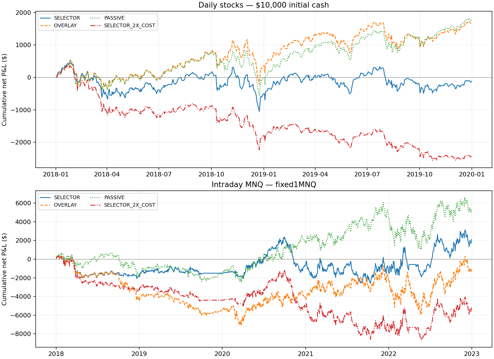

# Corrected stock and MNQ RL builds: REJECT tested selectors

Summary: Both requested Python strategies are built and tested with causal fills, integer positions and reconciled costs.
Neither primary quarterly PPO/A2C/DDPG selector passes its frozen design gate; neither earns a trading-plan allocation.
These are corrected adaptations of SSRN3690996, not a replication of the paper's reported return.
The tables below contain observed net returns; later periods, seed confirmations and Apex portfolio simulations were not earned.

Plan: [frozen protocol](../plans/rl3690996_build_20261030.md), committed `30187666db966efde21fdbeb7e2c0bdc69927522`.
Exact tested engine/environment/trainer committed before returns: `5d4af14174e754caa083125fded1808878e8ae87`.
Script: `analysis/codex_rl3690996_train.py`; [build/reproduction guide](../code/rl3690996/README.md).
Output: `analysis/outputs/codex_rl3690996_build/`; postrun reconciliation: `ledger_verification.json`.
Trials: two adaptations, each four candidates + three declared diagnostic controls + one doubled-cost stress = 16 economic series.
One primary seed3690996; 8,192 training steps per algorithm/quarter. No outcome-based tuning, seed replacement or failed-run deletion.

## Rules and mechanism as tested

The proposed mechanism is adaptive exposure to technical trends while reducing exposure during return turbulence.
It is an allocation hypothesis, without a demonstrated forced-flow or liquidity premium. Quarterly selection can also overfit
the preceding validation window. The source paper's13% annual return and Sharpe1.30 are author claims from another protocol.

**Stocks:** $10,000 cash-funded, long-only, static28-name source panel; DD/RTX excluded before returns for unresolved
merger/spin-off accounting. PPO/A2C/DDPG observe close-derived return/MACD/RSI/CCI/ADX, cash and holdings.
Positive normalized action weights are capped at10% per name; residual stays cash. Integer close-sized targets execute at
the following session's raw-open proxy, sells first, fee-inclusive cash clipping. Costs per side:10bp commission +5bp
adverse slippage. A strictly past-calibrated95th-percentile turbulence overlay targets cash. Shares/splits and cost basis
are ledgered; no dividends. PASSIVE is daily equal-weight target, OVERLAY adds turbulence, LINEAR uses positive63-day momentum.

**MNQ:** -1/0/+1 contract on NQ minute bars as an MNQ execution proxy, $2/point. Completed5-minute RTH observations
08:35–14:55 CT execute at the following minute open; final liquidation14:56. Fixed stop .5 prior15-session RTH ATR,
capped by remaining$250 session strategy-loss budget per contract. Entry-minute stops are active; opening gaps fill at
the worse opening price, then adverse slippage. Reversals pay both legs. A loss latch prevents further entries when
remaining budget cannot cover roundtrip costs. Costs per side: $0.62 commission +one adverse tick ($0.50), $2.24 roundtrip.
PASSIVE is long RTH with these stops/latch/flatten; OVERLAY adds turbulence; LINEAR uses MACD sign plus turbulence.
Only complete observed08:31–15:00 sessions are admitted. The$250 strategy budget is not an Apex trailing floor.

For both, expanding fit ends before a63-session validation window. The highest validation daily Sharpe selects the
following quarter's model, ties PPO/A2C/DDPG. Models are fit independently each quarter. Stock trade holdings carry
between quarters; validation starts flat; futures flatten daily. Fit/validation/trade boundaries are recorded in `selections.csv`.

## Daily stocks: 20180102–20191231

503 admitted sessions. $10,000 starting cash; net marked-to-market price returns, dividends omitted.

Net results after the costs above. CAGR uses252 admitted sessions/year; excluded sessions are not imputed.

| Policy | Net | CAGR* | Sharpe | Sortino | Closed PF† | Calmar | Ulcer % | Max DD | Max DD % |
| --- | --- | --- | --- | --- | --- | --- | --- | --- | --- |
| PPO | $-1,773.23 | -9.32% | -0.85 | -1.13 | 0.81 | -0.37 | 13.59 | $2,405.65 | 23.13% |
| A2C | $-1,538.74 | -8.03% | -0.72 | -0.95 | 0.81 | -0.32 | 14.24 | $2,409.92 | 23.03% |
| DDPG | $-187.22 | -0.94% | -0.02 | -0.02 | 0.96 | -0.06 | 6.47 | $1,531.93 | 14.69% |
| SELECTOR | $-120.41 | -0.61% | 0.01 | 0.01 | 0.97 | -0.04 | 6.14 | $1,515.08 | 14.48% |
| PASSIVE | $1,790.23 | 8.60% | 0.74 | 1.01 | 3.09 | 0.65 | 3.67 | $1,384.64 | 12.78% |
| OVERLAY | $1,701.19 | 8.19% | 0.74 | 1.02 | 1.43 | 0.62 | 3.63 | $1,380.47 | 12.36% |
| LINEAR | $313.26 | 1.56% | 0.20 | 0.26 | 0.99 | 0.16 | 4.96 | $972.43 | 9.27% |
| SELECTOR_2X_COST | $-2,432.50 | -13.03% | -1.11 | -1.43 | 0.69 | -0.42 | 18.51 | $2,930.15 | 28.27% |

*CAGR is session-annualized research NAV. †Stock PF uses average-cost partial-sale realizations, not independent complete round trips; stock NAV includes unrealized P&L. MNQ PF uses closed intraday round trips.

Cost bridge on actual executed quantities (gross is a bookkeeping add-back, not a separately rerun frictionless policy):

| Policy | Gross | Commissions | Slippage | Net |
| --- | --- | --- | --- | --- |
| PPO | $1,945.33 | $2,479.04 | $1,239.52 | $-1,773.23 |
| A2C | $1,790.47 | $2,219.47 | $1,109.74 | $-1,538.74 |
| DDPG | $2,149.73 | $1,557.97 | $778.98 | $-187.22 |
| SELECTOR | $2,358.36 | $1,652.52 | $826.26 | $-120.41 |
| PASSIVE | $1,873.88 | $55.77 | $27.88 | $1,790.23 |
| OVERLAY | $2,185.42 | $322.82 | $161.41 | $1,701.19 |
| LINEAR | $1,517.04 | $802.53 | $401.26 | $313.26 |
| SELECTOR_2X_COST | $1,904.85 | $2,891.57 | $1,445.78 | $-2,432.50 |

Realization/trade diagnostics (same PF basis as above; daily t uses dollar P&L and Newey–West5):

| Policy | Realizations/trades | Win rate | Average realization/trade | Daily NW5 t |
| --- | --- | --- | --- | --- |
| PPO | 3154 | 48.48% | $-0.59 | -1.42 |
| A2C | 3052 | 48.66% | $-0.56 | -1.22 |
| DDPG | 2581 | 50.33% | $-0.12 | -0.12 |
| SELECTOR | 2623 | 50.93% | $-0.09 | -0.08 |
| PASSIVE | 227 | 67.84% | $2.79 | 1.07 |
| OVERLAY | 645 | 61.24% | $1.92 | 1.04 |
| LINEAR | 2133 | 48.76% | $-0.02 | 0.23 |
| SELECTOR_2X_COST | 2514 | 44.59% | $-1.00 | -1.75 |

Annual net dollars:

| Year | PPO | A2C | DDPG | SELECTOR | PASSIVE | OVERLAY | LINEAR | SELECTOR_2X_COST |
| --- | --- | --- | --- | --- | --- | --- | --- | --- |
| 2018 | $-905.77 | $-1,187.81 | $-570.82 | $-515.05 | $-5.01 | $355.76 | $-154.65 | $-1,798.40 |
| 2019 | $-867.47 | $-350.93 | $383.60 | $394.63 | $1,795.24 | $1,345.43 | $467.91 | $-634.10 |

Signed additional-cost headroom on recorded quantities: $-0.006809 per share-side. A negative value means an equal cost reduction would be required to break even on this recorded path; it is not a rerun with different costs, positions or cash constraints.

Frozen selector advancement gate:

| Check | Outcome |
| --- | --- |
| net_positive | FAIL |
| mean_beats_overlay | FAIL |
| mean_beats_passive | FAIL |
| incremental_NW5_ge2 | FAIL |
| doubled_cost_positive | FAIL |
| positive_years | FAIL |

SELECTOR-minus-OVERLAY daily-return Newey–West(5) t=-3.655; required >=2.

**Design fails.** No seed17/29 confirmations, reserved-period test, rescue tuning or dependent portfolio/account test.

Quarterly earlier-window choices: 2018Q1: A2C, 2018Q2: DDPG, 2018Q3: DDPG, 2018Q4: DDPG, 2019Q1: DDPG, 2019Q2: DDPG, 2019Q3: DDPG, 2019Q4: DDPG.

Long-only; shorts N/A. A positive stock price return alone is insufficient: the selector must beat its risk-overlay and passive controls under the preregistered tests.

## Intraday MNQ: 20180102–20221230

1238 admitted sessions. Fixed1MNQ, no size compounding. Sharpe/Sortino use daily dollar P&L, consistent with validation selection; percentage/CAGR metrics use a$10,000 analytical denominator, not Apex account equity or return on margin. The trainer's original NAV-return Sharpe remains in summary.csv; reporting metrics are retained separately in report_metrics.csv. Its advancement gate uses analytical NAV returns, as recorded below.

Net results after the costs above. CAGR uses252 admitted sessions/year; excluded sessions are not imputed.

| Policy | Net | CAGR* | Sharpe | Sortino | Closed PF† | Calmar | Ulcer % | Max DD | Max DD % |
| --- | --- | --- | --- | --- | --- | --- | --- | --- | --- |
| PPO | $2,770.16 | 5.10% | 0.22 | 0.36 | 1.03 | 0.12 | 19.14 | $4,887.12 | 47.08% |
| A2C | $3,552.90 | 6.38% | 0.25 | 0.39 | 1.03 | 0.20 | 13.00 | $3,546.44 | 29.48% |
| DDPG | $-19,904.36 | N/A | -1.36 | -2.08 | 0.90 | -0.17 | 144.32 | $23,496.66 | 230.60% |
| SELECTOR | $2,089.88 | 3.94% | 0.15 | 0.24 | 1.02 | 0.09 | 20.35 | $4,964.58 | 40.19% |
| PASSIVE | $5,403.96 | 9.19% | 0.32 | 0.51 | 1.05 | 0.22 | 13.32 | $5,024.36 | 31.28% |
| OVERLAY | $-1,065.82 | -2.27% | -0.06 | -0.10 | 0.99 | -0.03 | 38.96 | $7,440.44 | 71.68% |
| LINEAR | $6,927.90 | 11.31% | 0.42 | 0.71 | 1.04 | 0.27 | 15.79 | $5,212.00 | 44.84% |
| SELECTOR_2X_COST | $-5,187.60 | -13.83% | -0.37 | -0.59 | 0.96 | -0.12 | 50.59 | $8,971.36 | 87.00% |

*CAGR is session-annualized research NAV. †Stock PF uses average-cost partial-sale realizations, not independent complete round trips; stock NAV includes unrealized P&L. MNQ PF uses closed intraday round trips.

Cost bridge on actual executed quantities (gross is a bookkeeping add-back, not a separately rerun frictionless policy):

| Policy | Gross | Commissions | Slippage | Net |
| --- | --- | --- | --- | --- |
| PPO | $9,078.00 | $3,491.84 | $2,816.00 | $2,770.16 |
| A2C | $11,930.50 | $4,637.60 | $3,740.00 | $3,552.90 |
| DDPG | $-2,457.00 | $9,658.36 | $7,789.00 | $-19,904.36 |
| SELECTOR | $10,015.00 | $4,387.12 | $3,538.00 | $2,089.88 |
| PASSIVE | $8,979.00 | $1,979.04 | $1,596.00 | $5,403.96 |
| OVERLAY | $8,438.50 | $5,261.32 | $4,243.00 | $-1,065.82 |
| LINEAR | $20,793.50 | $7,675.60 | $6,190.00 | $6,927.90 |
| SELECTOR_2X_COST | $10,582.00 | $8,729.60 | $7,040.00 | $-5,187.60 |

Realization/trade diagnostics (same PF basis as above; daily t uses dollar P&L and Newey–West5):

| Policy | Realizations/trades | Win rate | Average realization/trade | Daily NW5 t |
| --- | --- | --- | --- | --- |
| PPO | 2816 | 46.70% | $0.98 | 0.53 |
| A2C | 3740 | 47.01% | $0.95 | 0.61 |
| DDPG | 7789 | 46.37% | $-2.56 | -3.19 |
| SELECTOR | 3538 | 47.46% | $0.59 | 0.35 |
| PASSIVE | 1596 | 43.55% | $3.39 | 0.78 |
| OVERLAY | 4243 | 46.38% | $-0.25 | -0.16 |
| LINEAR | 6190 | 42.60% | $1.12 | 1.09 |
| SELECTOR_2X_COST | 3520 | 46.51% | $-1.47 | -0.86 |

Annual net dollars:

| Year | PPO | A2C | DDPG | SELECTOR | PASSIVE | OVERLAY | LINEAR | SELECTOR_2X_COST |
| --- | --- | --- | --- | --- | --- | --- | --- | --- |
| 2018 | $-1,901.70 | $1,121.70 | $-7,160.10 | $-1,863.20 | $-1,832.90 | $-4,401.42 | $661.04 | $-3,307.46 |
| 2019 | $339.46 | $-2,227.36 | $-2,123.86 | $358.18 | $241.82 | $-1,079.90 | $-2,322.18 | $-1,088.18 |
| 2020 | $-816.06 | $2,727.94 | $-6,432.28 | $818.10 | $3,534.80 | $1,400.92 | $928.24 | $-819.76 |
| 2021 | $1,573.86 | $-230.06 | $-4,623.20 | $-680.40 | $2,579.24 | $1,806.90 | $5,613.68 | $-2,364.44 |
| 2022 | $3,574.60 | $2,160.68 | $435.08 | $3,457.20 | $881.00 | $1,207.68 | $2,047.12 | $2,392.24 |

Signed additional-cost headroom on recorded quantities: $0.295348 per contract-side. A negative value means an equal cost reduction would be required to break even on this recorded path; it is not a rerun with different costs, positions or cash constraints.

Frozen selector advancement gate:

| Check | Outcome |
| --- | --- |
| net_positive | PASS |
| mean_beats_overlay | FAIL |
| mean_beats_passive | FAIL |
| incremental_NW5_ge2 | FAIL |
| doubled_cost_positive | FAIL |
| positive_years | FAIL |

SELECTOR-minus-OVERLAY daily-return Newey–West(5) t=-0.222; required >=2.

**Design fails.** No seed17/29 confirmations, reserved-period test, rescue tuning or dependent portfolio/account test.

Quarterly earlier-window choices: 2018Q1: A2C, 2018Q2: A2C, 2018Q3: PPO, 2018Q4: PPO, 2019Q1: A2C, 2019Q2: PPO, 2019Q3: PPO, 2019Q4: PPO, 2020Q1: PPO, 2020Q2: A2C, 2020Q3: PPO, 2020Q4: DDPG, 2021Q1: DDPG, 2021Q2: PPO, 2021Q3: A2C, 2021Q4: A2C, 2022Q1: PPO, 2022Q2: A2C, 2022Q3: PPO, 2022Q4: PPO.

Fixed-size dollar-P&L diagnostic: selector minus overlay net $3,155.70, NW5 daily-dollar difference t=0.421. The frozen gate above uses each strategy's evolving analytical-NAV daily returns; its arithmetic-mean ranking can differ from net dollars when capital paths differ. This reporting diagnostic does not replace the frozen gate. The selector also fails the passive comparison, doubled-cost and positive-year checks.

Selected MNQ side attribution (isolated side P&L; Sharpe/Sortino use daily dollars; DD includes initial capital):

| Side | Net | Trades | Win rate | Sharpe | Sortino | PF | Calmar | Ulcer | Max DD | Daily t |
| --- | --- | --- | --- | --- | --- | --- | --- | --- | --- | --- |
| long | $5,226.94 | 2694 | 47.07% | 0.46 | 0.73 | 1.06 | 0.37 | 13.11 | $2,891.18 | 1.08 |
| short | $-3,137.06 | 844 | 48.70% | -0.39 | -0.63 | 0.92 | -0.13 | 22.11 | $5,050.46 | -0.90 |

Worst completed session: $-249.98; worst minute adverse equity versus session start: $-249.98.

Sessions below nominal-$250 loss budget: 0. Gap/slippage risk is retained, not clipped from reported losses.

## Net equity paths

The panels use different periods and exposure, not equal risk. Lines plot cumulative net dollars; the doubled-cost
line is a rerun of the frozen selector without selecting a different model.

## Verification, placebos and account placement

All12 pre-return synthetic mechanics groups pass (`mechanics.json`): next-bar clocks, fee-inclusive cash, integer shares,
split/basis continuity, reversal legs, entry-minute stop/gap, final flatten/latch, missing-bar rejection, causal-feature
prefix invariance and Gym interface bounds. Independent postrun CSV replay verifies every reported policy's fee/slippage,
cash/shares/NAV or native-contract roundtrip/daily P&L and chronological folds/selection (`ledger_verification.json`).
This is implementation verification, not independent economic replication or a live fill certificate.

The declared passive/overlay/linear policies and doubled-cost stress are completed controls. Neither selector passes the
cheap design gate, so random-time/side and random-drop placebos, reserved-period bootstrap, seed confirmations, Apex
Monte Carlo and BASE/ADD/REPLACE/EMPTY account contribution tests are **not run**, following the stop rule. No claim of
measured portfolio harm, diversification, payout benefit or trail safety is made. Four candidates per profile plus all
controls/stress count in the research record. Design significance is not multiplicity-adjusted promotion.

| Home | Stock version | MNQ version |
| --- | --- | --- |
| Personal | No earned place: failed design; data limits remain | No earned place: failed design |
| 50K evaluation | Ineligible cash-stock/overnight instrument | No earned place; account/floor tests not earned |
| 150K evaluation | Ineligible cash-stock/overnight instrument | No earned place;2MNQ sizing/account tests not earned |
| 50K funded | Ineligible cash-stock/overnight instrument | No earned place; payout/contribution tests not earned |
| 150K funded | Ineligible cash-stock/overnight instrument | No earned place; payout/contribution tests not earned |

## What could make these estimates wrong

- Stock data are the author's static historical panel, not a certified point-in-time constituent universe. Dividends
  are missing; unresolved DD/RTX lineages were excluded before outcomes. Known factor-ratio splits are handled, but
  authoritative ex-date cash/merger/rights/auction and settlement accounting are not certified. The panel ends2020-08-17,
  making2023+ stock validation impossible here. Stock2018–2019 is an explicitly narrower design, not a canonical2018–2022 test.
- Futures use a continuous NQ grid as an MNQ proxy, without contract-specific bid/ask/queue/latency certification.
  Across the prepared2017–2026 input97 incomplete RTH sessions were excluded and enumerated. Results condition on
  complete observed sessions, including the design's admitted subset; missing/holiday sessions are not invented zero returns.
- Native stop/gap assumptions and the$250 strategy loss latch do not simulate Apex intraday floors, resets, consistency
  or payouts. Doubled costs rerun the frozen policy's execution but do not retrain or reselect it under stress.
- One seed and a deliberately bounded8,192-step fit per algorithm/quarter do not establish learning convergence or
  a failure of all RL. These results reject these frozen implementations at this compute budget. All predictions are
  historical walk-forward research; previously inspected history is not a fresh prospective holdout.
- The standalone MNQ DDPG diagnostic loses more than the$10,000 normalization capital. Its originally saved evolving-NAV
  return ratios cross zero and are not useful performance measures. This report uses fixed-size dollar-P&L Sharpe/Sortino
  and leaves its CAGR N/A. The experiment is not a solvency/margin-constrained futures account simulation.
- Daily stock open/close marks omit intraday adverse excursions. Stock drawdown is a daily NAV measure; MNQ retained
  minute adverse records are separate from the reported daily-equity drawdown. Size/capital differs, so dollar or
  percentage results do not compare equal risk between the adaptations.

## Code and next action

Both Python strategy environments, learners, selectors and complete ledgers are delivered; model ZIPs/features remain
Git-ignored runtime artifacts with hash-bound cache receipts. The [guide](../code/rl3690996/README.md) gives environment,
raw-input provenance and exact reproduction commands. No PowerLanguage version was made: the financial gate failed,
and translating a neural policy also requires its trained weights/state pipeline. No live/broker/VPS/plan files changed.

Do not allocate these selectors or tune them against the failed design. Tell Claude to independently review
`agents/codex/results/rl3690996_build_20261030.md`. The execution lessons remain under E58 in
[the execution-reference library](../EXECUTION_REFERENCES.md); the original engine audit is retained separately.
