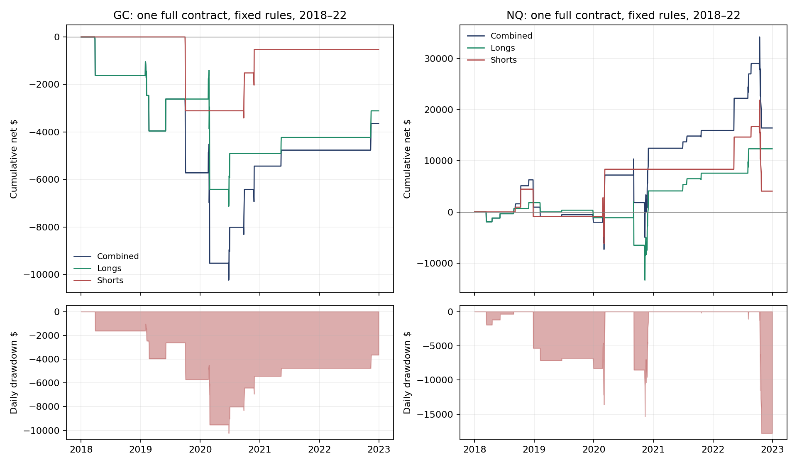

# RSI/Bollinger on gold and NQ: REJECT — neither passes the frozen design screen

Summary: Tested the uploaded hourly RSI/Bollinger rules separately on GC and NQ, 2018–22, with overnight holds.
Gold: 14 trades, -$3,641.50 net, t -0.51; NQ: 24 trades, $16,401.00 net, t 0.76.
NQ's positive total is weak evidence: daily Sharpe 0.28, max daily drawdown $17,773.62 per full contract.
Both fail the >=30-trade and t>=2 gates; delayed/stricter fills do not rescue the evidence. 2023+ stays unopened.
Do not advance this tested version to live or sizing; the video's crypto results are not futures validation.

Plan: [`rsi_bollinger_screen.md`](../plans/rsi_bollinger_screen.md), committed **d299ce1 before returns**.
Evidence: [`rsi_bollinger_standalone.md`](../evidence/rsi_bollinger_standalone.md).
Scripts: `analysis/codex_rsi_bollinger_screen.py`, `analysis/codex_rsi_bollinger_report.py`.
Outputs: `analysis/outputs/codex_rsi_bollinger_screen/`. Trials: **4 market/execution combinations; no search**.

## Rule (as tested)

Hourly decisions. Four-hour RSI(14)>70 for longs / <30 for shorts; price above/below four-hour Supertrend(10,3).
ADX(14)>20 hourly and >40 four-hour on both sides. Passive entry at the hourly lower/upper Bollinger(20,2)
band. Cancel/refresh pending orders each hour. At fill, recompute hourly ATR and opposite band using only the
visible forming hour, set a six-ATR stop and fixed opposite-band target. No trailing, moving target or time exit.
The supplied class executes the signals and on_open_position brackets; original source bytes are preserved.

Primary activation next minute, GC one tick / NQ one point of trade-through for entry and target. Stress activation
one minute later and double trade-through. All levels rounded to contract ticks; no favorable limit improvement
is credited. The minute OHLC nearest-extreme path determines ambiguity. Only the path after entry can trigger
its brackets. Opening gaps honor an already-resting stop/target before later extremes. The existing grid._walk
is reused with causal entry-path and carried-open extensions. Costs: GC $27.25 / NQ $17.25 per full-contract round
trip, including conservative slippage charged on passive fills as well. These are assumed research costs.

Fixed one GC or one NQ isolates the edge; this is an explicit adaptation of the source's crypto quantity helper
followed by times-five sizing. It does not reproduce either the video equity curve or a 3%-risk personal account.
No risk sizing, compounding, micro-contract rounding or margin sufficiency was inferred from these results.

Only 2018–22 minute files were opened for this RSI screen. The separate gold breakout task read 2017–22.
Both RSI markets start with 2018 data, warm up 240 visible four-hour and hourly bars and first become eligible
at **2018-02-23 13:00 UTC**. Dates before that contain no strategy trades. Continuous exports are CT close-stamped;
subtract one minute, convert DST-aware to UTC, aggregate observed UTC-clock hours. The partially formed current
four-hour candle is visible; its future extrema/close are never visible. Closures are absent observations.

## Results

All figures are per fixed full contract, not per micro and not an account-sizing recommendation. Daily marked
P&L includes unrealized changes across holding days. Maximum drawdown here is on daily marks; intraday exposure
can be worse. $50k is only the denominator for Ulcer/annualized reporting. PF, win rate and t use closed trades;
daily risk metrics use marked equity. Full side/year/stress tables are retained in `metrics.csv`.

### GC: design gate FAIL

| Side | Trades | Win | Net/trade | t | Sharpe | Sortino | PF | Calmar | Ulcer | Max daily DD |
|---|---:|---:|---:|---:|---:|---:|---:|---:|---:|---:|
| all | 14 | 64.3% | -$260.11 | -0.51 | -0.25 | -0.30 | 0.70 | -0.07 | 9.99 | $10,238.88 |
| long | 11 | 63.6% | -$282.70 | -0.51 | -0.24 | -0.28 | 0.66 | -0.08 | 7.73 | $7,131.62 |
| short | 3 | 66.7% | -$177.25 | -0.12 | -0.08 | -0.10 | 0.83 | -0.03 | 2.90 | $3,410.88 |

Gross -$3,260.00; net -$3,641.50; average gross -$232.86 versus
$27.25 costs. Double costs: -$4,023.00. Stress: 13 trades,
-$4,224.25 net, t -0.60. Mean holding time 47.8 hours;
longest 146.0 hours. Terminal open positions: 0.

Actual closed-trade SD $1,898.73 implies an approximate t=2 net-mean hurdle of $1,014.92,
against observed -$260.11. Independence is only an approximation; small support does not become reliable
because the win rate is high. Failed gates: `support_ge30, net_t_ge2, gross_ge1_5cost, stress_positive, double_cost_positive`. Do not promote or select a side-only rescue.

Calendar-year marked-to-market net (cross-year positions contribute to each holding year's marks):

| Year | Combined | Longs | Shorts |
|---|---:|---:|---:|
| 2018 | -$1,617.25 | -$1,617.25 | $0.00 |
| 2019 | -$4,103.50 | -$996.25 | -$3,107.25 |
| 2020 | $283.75 | -$2,291.75 | $2,575.50 |
| 2021 | $672.75 | $672.75 | $0.00 |
| 2022 | $1,122.75 | $1,122.75 | $0.00 |

10-session-block design bootstrap 90% daily-Sharpe interval: [-0.86, 0.54].
Conditional random-side p=0.993 for at least the observed net dollars.
The largest loss is -$4,667.25.

Pre-return opportunity audit; these are all signal hours, including those when an existing position would block
entry. Unfilled counts are for the prescribed direction, conditional on an observed activation minute. They are
not executed-trade counts and do not include subsequent single-position blocking. No wrong-side brackets occurred.

| Variant | Signal hours | Missing activation minute | No strict limit fill | Invalid bracket |
|---|---:|---:|---:|---:|
| primary | 1203 | 107 | 1078 | 0 |
| stress | 1203 | 56 | 1130 | 0 |

### NQ: design gate FAIL

| Side | Trades | Win | Net/trade | t | Sharpe | Sortino | PF | Calmar | Ulcer | Max daily DD |
|---|---:|---:|---:|---:|---:|---:|---:|---:|---:|---:|
| all | 24 | 75.0% | $683.38 | 0.76 | 0.28 | 0.38 | 1.57 | 0.18 | 8.08 | $17,773.62 |
| long | 16 | 75.0% | $770.88 | 0.94 | 0.36 | 0.51 | 2.16 | 0.16 | 4.44 | $15,337.25 |
| short | 8 | 75.0% | $508.38 | 0.22 | 0.08 | 0.12 | 1.23 | 0.04 | 6.86 | $17,773.62 |

Gross $16,815.00; net $16,401.00; average gross $700.62 versus
$17.25 costs. Double costs: $15,987.00. Stress: 24 trades,
$16,301.00 net, t 0.75. Mean holding time 59.7 hours;
longest 534.1 hours. Terminal open positions: 0.

Actual closed-trade SD $4,408.75 implies an approximate t=2 net-mean hurdle of $1,799.86,
against observed $683.38. Independence is only an approximation; small support does not become reliable
because the win rate is high. Failed gates: `support_ge30, net_t_ge2`. Do not promote or select a side-only rescue.

Calendar-year marked-to-market net (cross-year positions contribute to each holding year's marks):

| Year | Combined | Longs | Shorts |
|---|---:|---:|---:|
| 2018 | $939.75 | $1,821.50 | -$881.75 |
| 2019 | -$2,951.75 | -$2,951.75 | $0.00 |
| 2020 | $14,456.00 | $5,235.50 | $9,220.50 |
| 2021 | $3,468.25 | $3,468.25 | $0.00 |
| 2022 | $488.75 | $4,760.50 | -$4,271.75 |

10-session-block design bootstrap 90% daily-Sharpe interval: [-0.33, 0.97].
Conditional random-side p=0.112 for at least the observed net dollars.
The largest win, $10,607.75, contributes 64.7% of total net; the largest loss is -$12,622.25. This is concentration reporting, not a rule that removes trades.

Pre-return opportunity audit; these are all signal hours, including those when an existing position would block
entry. Unfilled counts are for the prescribed direction, conditional on an observed activation minute. They are
not executed-trade counts and do not include subsequent single-position blocking. No wrong-side brackets occurred.

| Variant | Signal hours | Missing activation minute | No strict limit fill | Invalid bracket |
|---|---:|---:|---:|---:|
| primary | 1209 | 57 | 1124 | 0 |
| stress | 1209 | 57 | 1125 | 0 |



2023 onward was **not opened** because both cheap design gates failed. No historical-replication table is fabricated.
The failed gate stops optimization, alternative thresholds, side-only versions, account sizing and forward promotion.

## Placebos and account level

Each market has 1,000 full single-position random-side replays at the original signal opportunity hours. Opposite
sides use their own band limit and fill-time ATR/target, with the same expiry, costs and execution. They can have
different trade counts, as a different limit may not fill. This is a conditional directional comparison, not an
independent test of timing. Both reported p-values and bootstrap intervals are diagnostic, not evidence that the
author's prior research/search is absent. A block bootstrap with so few trade episodes is itself uncertain.

No funded addition/replacement bench or Apex blow-up claim: the rules hold overnight and failed their edge gates.
No personal-account capital or compound-return estimate was run. Removing a formal trailing drawdown limit
does not remove losses, gap exposure or margin calls. Portfolio occupancy was not used to select test events;
joint portfolio diversification remains unmeasured, and GC/NQ trades were not pooled as independent observations.

## What could make this wrong

- **Different market and engine.** The video tests BTC and then ETH/DOGE, not futures. The exact original Jesse
  release and venue data are unknown. This uses pinned official Rust 1.3.1 kernels / SDK reference
  `9a3ebe075d9d0af5f012f921f46c2286f234af68` through a research adapter, not a full Jesse engine reproduction.
- **Small, selected video sample.** The transcript's final single-asset example reports 37 BTC trades over roughly
  3.5 years after inspecting sizing and correcting the short-direction bug. Adding correlated coins yields 75
  trades in the video; that does not establish 75 independent risk episodes or validate the GC/NQ transfer.
  The author explicitly says the fivefold quantity multiplier no longer preserves 3% risk. High win rates alone
  do not establish expectancy: this GC version wins about 64% and still loses overall.
- **Fills.** No quote, queue-position or tick-order history was supplied. The required trade-through, adverse costs
  and activation stress are conservative OHLC assumptions, not verified live fills. ATR/bands at fill include only
  a reconstructed observable path prefix; actual intraminute arrival order can differ from that path.
- **Continuous data.** Roll/back-adjustment provenance and contract-level executable quotes remain unverified.
  Large moves were not removed to improve the result; roll or missing-minute effects can change multi-day P&L.
  Grid24 drops duplicate date/time input rows; manifests' duplicate counts refer to the later UTC-observation check.
- **Adaptations.** Crypto quantities become one full futures contract, prices are tick-rounded, and the market
  calendar follows owned observations. The undefined watch_list.bbw UI call is not invoked. These choices are
  disclosed and frozen, not claims of a repaired production strategy or video-result reproduction.

## Verification and reproducibility

Source-method fixtures check both entry directions, cancellation and frozen brackets. Execution fixtures check
strict entry trade-through, hourly expiry, exclusion of a target hit before entry, stop protection on the entry
minute and stop/target priority on opening gaps. Prefix rebuilds check both an active exact four-hour boundary
and a subsequent partial four-hour bucket against full-history decisions. All passed; zero invalid brackets.
The carried-target gap guard was added during implementation verification; all four variants and controls were
rerun under the same frozen rule. This is a correctness fix, not a selected alternate strategy.

The manifest records all input SHA256 values and first warm-up time; the pre-return audit records eligibility
before return replay. Planning power arithmetic uses declared SD assumptions and is saved separately from actual
trade SD. Reproduction hashes and dependency versions are in `reproduction.json`; seed 314159.

```bash
/workspace/venvs/thebeginning/bin/python analysis/codex_rsi_bollinger_screen.py
/workspace/venvs/thebeginning/bin/python analysis/codex_rsi_bollinger_report.py
```

## Differences between MultiCharts code and the test

No MultiCharts strategy or live files were written. This is a personal-account research adaptation with overnight
holds, so it cannot be copied unchanged into the current intraday Apex plan. Send this result to Claude for review;
the tested versions fail and need no live implementation.
