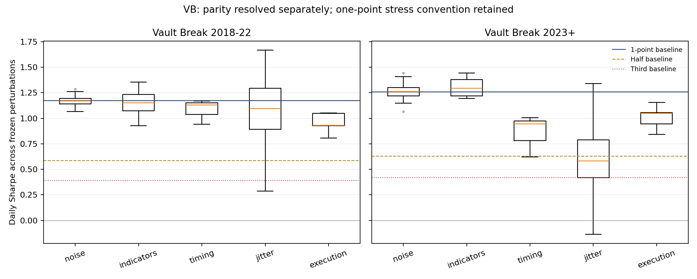

# Vault Break: WATCH — parity passes; fixed stress audit is MIXED / WATCH

Summary: Registered .25-point target-through reproduces MC under the original gate: 1,736/1,743 entries (99.60%), matched gross P&L exact.
Completed all 314 frozen VB stress runs using the original 1-point research rule; four families BENDS, joint jitter MIXED.
2023+ jitter median Sharpe 0.58 versus 1.26 baseline; 99% profitable, 44% keep half baseline Sharpe.
No family BREAKS; a 30-minute entry delay remains profitable but weakens recent results. No replacement setting selected.
This completes the existing audit; no trading-plan, live or logger change follows.

Plan: [`vb_parity_trade_through_amendment.md`](../plans/vb_parity_trade_through_amendment.md), **efcd75e committed before the new parity replay**.
Original plan: [`break_vb_onb.md`](../plans/break_vb_onb.md), **109a752**. Review snapshot: **d82cbd39928e9d1cb63a883e66e3de019cb76dfe**.
Scripts: `analysis/codex_vb_parity_stress.py`, `analysis/codex_vb_parity_stress_report.py`, unchanged original audit helpers.
Outputs: `analysis/outputs/codex_vb_parity_stress/`. New scenario replays: **316 = 2 baselines + 314 stresses**.
The .25 baseline is a parity diagnostic, not an economic trial; this completes the existing VB robustness trial.
No ONB rerun, new hypothesis, fitted parameter, placebo search or best-case selection.

## Rule and execution conventions

Unchanged VB: noise .30×ATR15 SMA from midnight open, midnight VWAP, first 10:00, last/flat 14:30,
40-point target, 75-point stop, max 3/day; holiday last 11:00/flat 11:30. One NQ, $20/point, .25 tick.
Round-trip commission $7.25 plus one adverse tick on market/stop fills; target exits pay no extra slippage.
Minute close stamps retain original timing; decisions enter the following minute's open. Original generators,
accelerated engine, indicators, date boundaries, costs and pairing function are unchanged and hash-checked.

Only the MC reproduction baseline permits target-through **.25 point**, based on the observed exit-bar highs.
The original diagnostic has 0 fills below .25 through, 19 at .25,
7 at .50, 17 at .75, 853 at >=1 point. This is consistent with a
one-tick reconstruction of this export's "exceeded by 1 points" setting. It does not establish every MC
configuration's semantics. The **1-point research baseline remains the denominator for every stress verdict**;
execution scenarios additionally test the originally specified 2-point-through cases. Stricter fills alter
holding/re-entry paths and need not lower every individual trade's P&L.

## Original baseline parity gate

Same report/date overlap: 2018-01-25 11:00:00 through 2026-10-09 16:00:00. Keys are date/side/native 30-minute entry bar.
No fuzzy matching, date deletion, changed warm-up or lowered gate. The original thresholds are >=98% matched
on each list, >=99% entry prices within .25, >=95% gross P&L within $20, gross correlation >=.98, and complete
overlapping-list mean-net gap <=max($20,10% of absolute MC mean). Each threshold passes for the .25 reference.

| Fill convention | Python / MC | Matched | Matched % Python / MC | Entry within tick | Gross within $20 | Gross corr | Mean-net gap | Gate |
|---|---:|---:|---:|---:|---:|---:|---:|---|
| 1-point research | 1729 / 1743 | 1700 | 98.32% / 97.53% | 100.0% | 99.35% | 0.9959 | -$10.50 | FAIL |
| .25-point parity only | 1741 / 1743 | 1736 | 99.71% / 99.60% | 100.0% | 100.00% | 1.0000 | -$3.07 | PASS |

Matched .25 gross-P&L maximum gap **$0.00**; entry-price maximum gap **0 point**.
Residuals: **5 Python-only and 7 MC-only**,
preserved in the complete pairing and `parity_quarterpoint_unmatched_causes.csv`. MC-only emulator facts:
four lack a qualifying Python signal, two occur while a Python position is still open, one after Python's
three-trade cap. Five Python-only entries have an unresolved MC-side cause. These facts do not claim a proven
source-data/indicator cause. The original gate permits these residuals; none were removed from its denominator.

Full-history Python baseline counts differ from overlap counts because the original report starts January 25,
2018 at 11:00. Exactly the same original overlap filter applies to both fill conventions.

## Baseline results — report both conventions

Per fixed one NQ after costs; all trades are long, so **combined=long and shorts N/A**. Short rows with zero
trades and undefined ratios remain explicit in the CSVs. Daily risk uses the complete trading-date calendar
and initial zero for drawdown; $50k is only the Ulcer denominator. No account/margin sizing is inferred.
"2018–26" ends **2026-10-09**, not a complete 2026 year.

| Fill convention | Period | Trades | Win | Net/trade | t | Sharpe | Sortino | PF | Calmar | Ulcer | Max DD |
|---|---|---:|---:|---:|---:|---:|---:|---:|---:|---:|---:|
| 1 point | 2018-22 | 861 | 63.3% | $76.41 | 2.71 | 1.17 | 1.77 | 1.24 | 1.22 | 3.74 | $10,512 |
| 1 point | 2023+ | 881 | 67.1% | $86.75 | 2.66 | 1.26 | 1.91 | 1.22 | 1.42 | 5.56 | $13,906 |
| 1 point | 2018-26 | 1742 | 65.2% | $81.64 | 3.78 | 1.20 | 1.81 | 1.23 | 1.14 | 3.47 | $13,906 |
| .25 point — parity only | 2018-22 | 866 | 63.6% | $83.56 | 2.98 | 1.30 | 1.98 | 1.27 | 1.56 | 3.47 | $9,062 |
| .25 point — parity only | 2023+ | 888 | 67.3% | $94.32 | 2.91 | 1.37 | 2.09 | 1.24 | 1.56 | 5.27 | $13,906 |
| .25 point — parity only | 2018-26 | 1754 | 65.5% | $89.01 | 4.15 | 1.31 | 2.00 | 1.25 | 1.25 | 3.22 | $13,906 |

| Year | 1-point trades | 1-point net | .25-point trades | .25-point net |
|---|---:|---:|---:|---:|
| 2018 | 135 | $3,916 | 136 | $4,569 |
| 2019 | 121 | $2,743 | 122 | $2,926 |
| 2020 | 201 | $22,088 | 201 | $22,548 |
| 2021 | 189 | $23,055 | 191 | $26,865 |
| 2022 | 215 | $13,986 | 216 | $15,459 |
| 2023 | 217 | $24,262 | 219 | $26,332 |
| 2024 | 214 | $11,844 | 216 | $12,614 |
| 2025 | 226 | $30,872 | 228 | $34,567 |
| 2026 | 224 | $9,451 | 225 | $10,239 |

The .25 convention is not selected as a more profitable strategy; it has one job: reconstruct the report.
The reproduced 1-point baseline matches the old saved baseline and original candidate trade by trade.

## Frozen stress families — 1-point baseline

BENDS requires >50% of runs profitable AND at least half base Sharpe in **both** periods, with positive base
Sharpe. BREAKS requires median net<=0 OR median Sharpe<third of base in **each** period. Otherwise MIXED/WATCH.
The family/overall thresholds were unchanged. No family satisfies BREAKS; formal overall verdict **MIXED / WATCH**.

| Family | Period | Runs | Median net | Median net/trade | Median t | Median PF | Median Sharpe | Median DD | Net>0 | Net>0 & t>2 | Net>0 & half SR | Verdict |
|---|---|---:|---:|---:|---:|---:|---:|---:|---:|---:|---:|---|
| noise | 2018-22 | 100 | $65,647 | $76.14 | 2.70 | 1.24 | 1.17 | $10,483 | 100.0% | 100.0% | 100.0% | BENDS |
| noise | 2023+ | 100 | $76,385 | $86.90 | 2.66 | 1.22 | 1.26 | $13,850 | 100.0% | 100.0% | 100.0% | BENDS |
| indicators | 2018-22 | 6 | $64,947 | $74.80 | 2.65 | 1.24 | 1.15 | $10,585 | 100.0% | 100.0% | 100.0% | BENDS |
| indicators | 2023+ | 6 | $77,876 | $89.10 | 2.72 | 1.22 | 1.30 | $14,197 | 100.0% | 100.0% | 100.0% | BENDS |
| timing | 2018-22 | 3 | $55,793 | $75.09 | 2.52 | 1.24 | 1.13 | $9,778 | 100.0% | 100.0% | 100.0% | BENDS |
| timing | 2023+ | 3 | $54,926 | $65.78 | 1.97 | 1.16 | 0.94 | $16,482 | 100.0% | 33.3% | 66.7% | BENDS |
| jitter | 2018-22 | 200 | $61,388 | $75.69 | 2.48 | 1.23 | 1.09 | $10,631 | 100.0% | 74.5% | 91.5% | MIXED / WATCH |
| jitter | 2023+ | 200 | $34,823 | $42.63 | 1.19 | 1.09 | 0.58 | $16,536 | 99.0% | 12.0% | 44.0% | MIXED / WATCH |
| execution | 2018-22 | 5 | $52,168 | $60.86 | 2.14 | 1.19 | 0.93 | $10,947 | 100.0% | 80.0% | 100.0% | BENDS |
| execution | 2023+ | 5 | $63,226 | $72.26 | 2.20 | 1.18 | 1.05 | $15,146 | 100.0% | 60.0% | 100.0% | BENDS |



These boxes show scenario sensitivity, not independent samples or confidence intervals. Both 1/2-tick noise
groups and all deterministic cases are retained; full run/side/year metrics include Sortino, Calmar and Ulcer
in `run_metrics.csv` and `stress_side_year_summary.csv`.

Timing deserves its own view despite the family BENDS result:

| Timing case | Period | Trades | Net/trade | t | Sharpe | Max DD |
|---|---|---:|---:|---:|---:|---:|
| entry_one_bar_later | 2018-22 | 743 | $75.09 | 2.52 | 1.132 | $8,112 |
| entry_one_bar_later | 2023+ | 737 | $44.11 | 1.27 | 0.622 | $17,146 |
| flat_earlier | 2018-22 | 804 | $62.12 | 2.18 | 0.942 | $9,778 |
| flat_earlier | 2023+ | 835 | $65.78 | 1.97 | 0.944 | $14,537 |
| flat_later | 2018-22 | 861 | $80.59 | 2.72 | 1.170 | $12,632 |
| flat_later | 2023+ | 881 | $70.50 | 2.09 | 1.005 | $16,482 |

The 30-minute delay's recent Sharpe is just below half baseline; 2 of 3 timing runs still clear the family
threshold. It stays profitable and above one-third baseline. It changes entry opportunity, not just price
slippage; this is no recommendation to alter execution. Deterministic loss/below-third flagged whole-strategy
rows: **0**; combined/long duplicates are identified in the saved flag tables.

## Joint jitter and remaining risk

200 accepted simultaneous ±10% draws; **783 raw**, **583 infeasible draws**
rejected on original chronological/calendar constraints before evaluating returns. Factors, proposed settings,
reasons and accepted outputs are all saved. No losing draw was discarded or replaced. Feasibility conditioning
induces dependence across the retained parameter values.

Design: 100% profitable, 91.5% positive+half baseline Sharpe.
2023+: 99% profitable, 12% positive+t>2,
44% positive+half baseline Sharpe; median DD **$16,536** versus
**$13,906** baseline. Mostly positive draws do not imply stable risk-adjusted returns.
Every joint draw's loss/below-third-baseline status and parameter vector is preserved in
`jitter_dependency_checks.csv` / `jitter_dependency_flags.csv`; **54** period/run rows trigger
at least one warning. These are joint-draw diagnostics, not isolated causal tests of a particular input.
The frozen clock jitter is broad: first entry 09:00–11:00, last/flat 13:00–15:30, holiday times as below.
Those move the session meaningfully. This is joint sensitivity; it does not identify a single causal parameter
or prove fragility to a tiny implementation error. No post-hoc one-input rescue or preferred draw was tested.

| VB input | Minimum | Maximum | Distinct after rounding |
|---|---:|---:|---:|
| mult | 0.2701 | 0.3291 | 170 |
| atr_n | 14 | 16 | 3 |
| first | 900 | 1100 | 5 |
| last | 1300 | 1530 | 6 |
| flat | 1300 | 1530 | 6 |
| tp_pts | 36 | 44 | 32 |
| sl_pts | 67.5 | 82.25 | 59 |
| max_trades | 3 | 3 | 1 |
| early_last | 1000 | 1100 | 3 |
| early_flat | 1030 | 1130 | 3 |

Clock values in this table are HHMM after proper minute-axis jitter; integer ATR and max-trade rounding are
explicit. Max-trades remains 3 in every accepted draw; it was perturbed but rounded back to the same value.

## Controls, uncertainty and applicability

The original seed 8675309 and SeedSequence children are unchanged. All 100 noisy grids use the identical seeds
already used for ONB; ATR/VWAP and signals/fills are recomputed from each grid. Noise volumes/NaN masks are
unchanged, projected OHLC and tick rounding enforced. The original 200 VB jitter draws use their reserved seed
child, not ONB's child. Indicator/anchor, timing and execution cases call the original functions unchanged.

2023+ one-point baseline daily-Sharpe 90% ten-session-block interval **[0.46, 2.09]**, 2,000 draws.
Other metric intervals and 2,000 drawdown permutations are saved; all=long, shorts N/A. These are conditional
historical uncertainty summaries, not a new holdout. No placebo rerun, new candidate promotion, funded bench,
account sizing or payoff claim is required or inferred from this unchanged-strategy robustness audit.

Review context: ONB's stress evidence was accepted, with its broad-clock jitter MIXED result interpreted as
an open-session dependency. The original formal metric result is preserved. RSI/Bollinger and XAU remain failed
screens. Execution diagnostics remain observations; the bid/ask logger remains a proposal requiring a test-chart
check before any separately authorized use. No live test/deployment, watchdog or Friday-runbook action here.

## Verification, limitations and reproduction

Original plan/helper/report dependency hashes and input CSV/cache hashes match the previous audit. The
read-only cache still starts with 2017-12-01 overnight observations and ends 2026-10-09. No warm-up input,
shared cache, minute series, source strategy, old report or old outputs were overwritten. Synthetic fixtures
verify touch refusal, one-tick target fill and recomputed re-entry sequencing; original engineering checks and
1-point original/accelerated/saved-ledger equivalence pass. All 12 checks pass.

Matching on native bars and gross P&L does not verify broker timestamps, spread, queue priority or intraminute
path. MC entry/exit minutes from `portfolio.load_mc` are inferred within reported bars; they are not actual
broker fill timestamps. Remaining signal/MC differences, continuous-contract provenance, holiday/provider
differences and OHLC ambiguity remain limitations. Passing the declared parity gate does not make them vanish.

```bash
/workspace/venvs/thebeginning/bin/python analysis/codex_vb_parity_stress.py --parity
/workspace/venvs/thebeginning/bin/python analysis/codex_vb_parity_stress.py --stress
/workspace/venvs/thebeginning/bin/python analysis/codex_vb_parity_stress_report.py
```

The stress command refuses a failed parity artifact or changed runner/source inputs. All original outputs are
preserved; this is a separate completion report. One .25 parity diagnostic and the reproduced 1-point baseline
are disclosed in addition to the 314 frozen stresses. The number of registered economic robustness trials stays
two across the original VB/ONB assignment; no new performance-selected hypothesis was introduced.

## Differences between MultiCharts code and test

No MultiCharts code was written. MC parity uses the registered .25-point threshold; research stress runs keep
the 1-point default and original 2-point execution cases. Existing order guards, market fallback, position/account
sizing and real-time broker behaviors remain outside this fixed-one-NQ historical test. No live decision follows.

Tell Claude: review `agents/codex/results/vb_parity_stress.md`; original gate passes at .25, all 314 frozen
1-point VB stresses are complete, overall MIXED/WATCH because of recent joint jitter. Nothing selected for trading.
