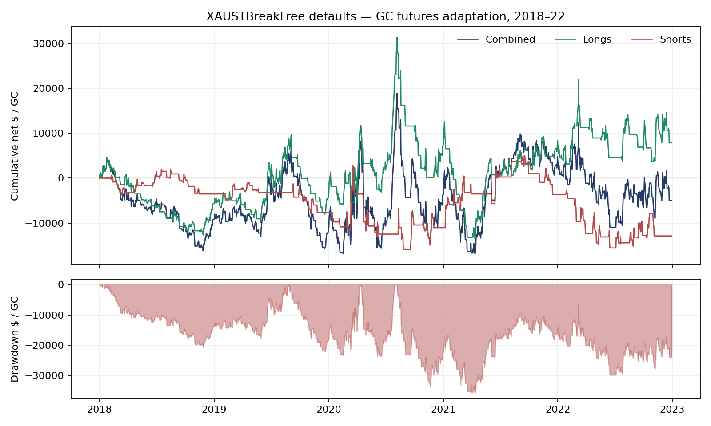

# Uploaded gold breakout: REJECT — fixed-default GC design screen fails

Summary: Tested the supplied XAUSTBreakFree defaults on GC futures, 2018–22, with overnight holds.
165 trades: gross -$500.00, net -$4,996.25, PF 0.98, t -0.10.
Marked daily Sharpe -0.05; max drawdown $35,877.50 per fixed one GC; only two positive years.
One-minute delay net -$11,683.50. Registered design gate fails; 2023+ remains unopened.
Reject further work on this tested version; RSI/Bollinger remains queued separately. No live changes.

Plan: `agents/codex/plans/xau_st_break_free_screen.md`, **498e12f**.
Evidence: [`xau_st_break_free.md`](../evidence/xau_st_break_free.md).
Scripts: `analysis/codex_xau_st_break_free.py`, `analysis/codex_xau_st_break_free_report.py`.
Outputs: `analysis/outputs/codex_xau_st_break_free/`. Trials: **2 execution variants; 0 parameter searches**.

## Rule (as tested)

One-hour GC breakouts of the prior 85 session-hour high/low, gated by four-hour Supertrend 24/4, EMA 10 and
ADX 10 long / 15 short. Long stop 3×ATR4 and trail 6.5×ATR4; short stop 4×ATR4, trail 3.5×ATR4 and target
5×ATR4. Exit-on-flip is zero. ATR uses period 14. All supplied defaults remain fixed; no optimization/DNA was supplied.

Signal methods are executed from the preserved class using official Rust indicators. Four-hour anchor visibility
matches the source's literal `[:-1]`, including discarding the just-completed bucket on a boundary. Hourly channel
excludes the current hour. UTC clock buckets, real CT→UTC conversion, New York schedule and observed bars only.
Entry is next-minute open, bracket active immediately, hourly trailing changes effective only afterward. Market
closed/missing-entry-minute signals are skipped. Costs are $27.25 per GC round trip, including conservative two-tick
slippage even for targets. Targets require a GC tick of trade-through; gap stops fill at the observed open.

## Results

Fixed one GC, daily marked P&L; $50k is a reporting denominator, not a recommended account balance. These are GC
adaptation results, not reproduced XAU-USD/video returns. Completed-trade means/t and daily risk metrics differ
in aggregation by design. The full year/side tables are in `metrics.csv`.

| Side | Trades | Win | Net/trade | t | Sharpe | Sortino | PF | Calmar | Ulcer | Max DD |
|---|---:|---:|---:|---:|---:|---:|---:|---:|---:|---:|
| all | 165 | 31.5% | -$30.28 | -0.10 | -0.05 | -0.07 | 0.98 | -0.03 | 28.23 | $35,877.50 |
| long | 72 | 26.4% | $109.42 | 0.20 | 0.09 | 0.12 | 1.07 | 0.03 | 26.71 | $44,831.50 |
| short | 93 | 35.5% | -$138.43 | -0.46 | -0.20 | -0.30 | 0.88 | -0.12 | 19.24 | $20,642.38 |

Gross average is -$3.03 versus $27.25 costs; commission/slippage total $4,496.25.
Double costs on the same trades produce -$9,492.50. Delay variant: 166
trades, -$70.38 net/trade, t -0.24, PF 0.95. No terminal position remains.
Mean holding duration is 200.1 clock hours; this is not an Apex-intraday strategy.

Calendar-year marked-to-market net P&L (a crossing-year trade contributes to each holding year's marks):

| Year | Combined | Longs | Shorts |
|---|---:|---:|---:|
| 2018 | -$9,165.63 | -$5,647.87 | -$3,517.75 |
| 2019 | -$2,746.50 | $1,389.50 | -$4,136.00 |
| 2020 | $8,310.75 | $11,691.25 | -$3,380.50 |
| 2021 | $8,358.00 | $1,003.00 | $7,355.00 |
| 2022 | -$9,752.88 | -$557.87 | -$9,195.00 |

The registered gates requiring t≥2, gross mean ≥1.5×cost, at least three positive years, positive delayed P&L and
positive double-cost P&L all fail; support ≥30 passes. 2023+ is **not opened**. Do not tune thresholds or select
long-only after these results. No frozen-rule holdout, account-sizing study or forward candidate follows a failed gate.

## Placebos and account level

1,000 conditional random-side full single-position replays at the original signal opportunity hours give
p=0.583 for net dollars at least as large as the tested rule. This controls direction
conditional on those hours, not independent timing skill. No filter/removal comparison was selected.
The design daily ten-session-block bootstrap gives a 90% Sharpe interval [-0.72, 0.65].
Side-specific bootstrap, permutation and closed-trade Monte Carlo outputs are saved; they describe conditional
uncertainty and sequence risk, not proof against the author's unknown prior search (its prompt asks for ≥200 variants).

Personal-account sizing was not run after design failure. Fixed one-GC drawdown is not a 3%-risk account result.
No Apex funded addition/replacement bench: overnight holds are ineligible and the design gate already failed.

## What could make this wrong

- Owned GC is a continuous futures export, not the author's XAU-USD history. Contract-level rollover/adjustment
  provenance and actual executable quotes remain unverified; no large gaps were deleted to improve results.
- Uploaded holiday overrides mostly cover 2026–27. Historical holiday closures enter through absent observed
  minutes; the source's historical provider/holiday agreement was not independently reproduced.
- This is an adapter plus the existing minute walker, not the full Jesse engine. Actual author framework version,
  DNA, spread, market-close entry fills and live partial-bar behavior may differ. The source's literal boundary lag
  was retained; interpreting its comment differently would create another variant, not a correction to this result.
- Fixed one GC isolates the edge before nonlinear risk/cap sizing. No claim is made that the original 3%-risk curve
  or actual MGC commissions were reproduced. Source risk sizing changes trade weights; this unweighted screen
  does not establish its exact compounded outcome.
- Trade t ignores serial dependence; marked daily bootstrap supplies complementary uncertainty. No inference of
  universal failure on every gold venue is made from this bounded diagnostic.

## Implementation verification and code differences

Source SHA256: `179fe4b717d7fa5b1c9fc93c66a3230ef6d9eb38c0cf6c57296e93d56f7bf098`. Data hashes and official reference pin are in `manifest.json`.
Only 2017–22 files were read: 1,792,617 observed minutes, zero invalid OHLC rows and zero
duplicate UTC rows. Future-prefix invariance, supplied long/short trailing formulas, entry-bar stop protection,
gap-at-open fills, stale delayed-order rejection and target touch/trade-through fixtures pass. Entry-eligibility
reconstruction matches every replayed entry; skip counts are in `execution_verification.json`.

No MultiCharts code written. Changes from source execution: GC data/point value/tick rounding, fixed one-contract
size instead of source risk sizing, next-minute observed fills instead of decision-close fills, missing/stale-entry
rejection and conservative repository costs/target trade-through. All were specified before returns. The minute
walker was reused and extended for carried-position first-minute gap checks; no shared engine file was changed.

Reproduce with `/workspace/venvs/thebeginning/bin/python analysis/codex_xau_st_break_free.py` then
`/workspace/venvs/thebeginning/bin/python analysis/codex_xau_st_break_free_report.py`.
Requires `jesse-rust==1.3.1` in addition to configured research dependencies; existing versions were not downgraded.

Tell Claude: review `agents/codex/results/xau_st_break_free_screen.md`; **REJECT** the tested GC defaults,
two frozen execution variants, failed 2018–22 gate, 2023+ unopened. RSI/Bollinger is a separate queued task.
